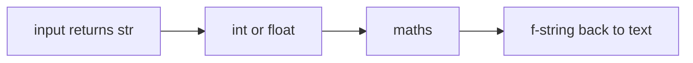

# Lesson 1.5: Variables and Data Types

**Course:** Python for AI · **Module 1:** Python Basics for GenAI and Agentic AI · **Updated:** Thu 15 Oct 2026

> **By the end:** You can store any value in a well-named variable, know the 5 core data types, convert between them safely, and write an AI model config like the ones real LLM APIs use.

---

## 1. Mental Model: A Variable is a Label on a Value

```python
model = "claude"
```

Python creates the value `"claude"` and sticks the label `model` on it. Use the label, get the value.

| Part | Meaning |
|---|---|
| `model` | The label (variable name) |
| `=` | "Stick this label on" (not "equals" in maths) |
| `"claude"` | The value |

Labels can move: `model = "gemini-4-argon"` sticks the same label on a new value.

---

## 2. The 5 Core Data Types

Every AI app config is built from these.

| Type | What it holds | AI example |
|---|---|---|
| `str` | Text | `model = "gemini-4-argon"` |
| `int` | Whole number | `max_tokens = 500` |
| `float` | Decimal number | `temperature = 0.7` |
| `bool` | `True` or `False` | `stream = False` |
| `None` | "No value yet" | `api_key = None` |

**Check any type with `type()`:**

```python
temperature = 0.7
print(type(temperature))  # <class 'float'>
```

**Mental model:** the type decides what you can do. You can do maths with `int` and `float`, but not with `str`.

---

## 3. Type Conversion (Casting)



| Code | Result | Note |
|---|---|---|
| `int("500")` | `500` | Text to whole number |
| `float("0.7")` | `0.7` | Text to decimal |
| `str(500)` | `"500"` | Number to text |
| `int(3.9)` | `3` | Cuts the decimal, does not round |
| `int("3.5")` | `ValueError` | Use `float()` first |
| `bool("")` | `False` | Empty text is False |
| `bool("False")` | `True` | **Trap:** any non-empty text is True |

**Golden rule:** values from `input()`, files and `.env` settings arrive as **text**. Convert them before doing maths.

---

## 4. Naming Rules (Pro Style)

| Rule | Good | Bad |
|---|---|---|
| Use `snake_case` | `max_tokens` | `MaxTokens`, `maxtokens` |
| Start with a letter or `_` | `model_2` | `2nd_model` |
| No spaces or hyphens | `user_prompt` | `user prompt`, `user-prompt` |
| Say what it holds | `price_per_1k` | `x`, `data2` |
| Never reuse built-in names | `user_input` | `input`, `print`, `type`, `str` |
| Constants in `UPPER_CASE` | `MODEL = "gemini-4-argon"` | |

Names are **case-sensitive**: `Model` and `model` are two different labels.

---

## 5. Useful Patterns

```python
# Several variables in one line
model, max_tokens = "claude", 300

# Update a value
tokens_used = 120
tokens_used = tokens_used + 80   # 200

# / always gives a float
print(10 / 2)                    # 5.0

# Floats are not exact: round money and scores
print(0.1 + 0.2)                 # 0.30000000000000004
print(round(0.1 + 0.2, 2))       # 0.3
```

**Pro preview, type hints:** professionals often label the expected type. Python does not enforce it, but tools like FastAPI and Pydantic use it to catch bugs.

```python
max_tokens: int = 500
temperature: float = 0.7
```

---

## 6. Mini Build: AI Model Config + Cost Estimate

```python
"""Lesson 1.5: An AI model config and a token cost estimate."""

MODEL = "gemini-4-argon"
temperature = 0.2          # low = focused, factual answers
max_tokens = 300
stream = False
system_prompt = "You are a helpful Python tutor."

# Example price for practice, not a real price list
price_per_1k_tokens = 0.5  # PKR

# int() because input() always returns text
tokens_used = int(input("Tokens used: "))
cost = tokens_used / 1000 * price_per_1k_tokens

print("--- Model Config ---")
print(f"Model: {MODEL}")
print(f"Temperature: {temperature} ({type(temperature)})")
print(f"Max tokens: {max_tokens}")
print(f"Streaming: {stream}")
print(f"Estimated cost: {round(cost, 2)} PKR")
```

**Industry link:** real LLM APIs take the same kind of settings. Anthropic's Messages API, for example, uses `model`, `max_tokens`, `temperature`, `system` and `stream`. In Module 2 you will pass these variables to a real model.

---

## 7. Common Errors

| Error | Cause | Fix |
|---|---|---|
| `NameError: name 'modle' is not defined` | Typo, or used before it was created | Check spelling and order (top to bottom) |
| `TypeError: can only concatenate str (not "int") to str` | Joining text and a number with `+` | Use an f-string |
| `ValueError: invalid literal for int()` | `int("3.5")` or `int("abc")` | Use `float()`, or type a valid number |
| `SyntaxError: invalid decimal literal` | Name starts with a digit, like `2nd_model` | Start with a letter: `model_2` |
| `TypeError: 'int' object is not callable` | You wrote `input = 5`, then called `input()` | Never reuse built-in names |

---

## 8. Job & Client Angle

- **Config bugs are type bugs.** A `temperature` read from a settings file as the text `"0.7"` can break an API call. Converting types correctly is a daily task.
- **Cost estimates win clients.** "1,000 chats a day will cost about X per month" is a number clients ask for before they say yes. It is just variables and maths.
- **Clear names** make your code easy for teammates, clients and AI coding agents to read and change.

---

## 9. Your Task (self-create)

Build an **AI Model Profile Card** in `code/lesson_05_variables.py`: store a model profile using `str`, `int`, `float` and `bool`, print each value with its `type()`, and estimate the cost of a chat from the user's token count.

**Full requirements, expected output, stretch goal and marking:** [Task 1.5: AI Model Profile Card](../assessments/module-1/checkpoint-2-code-tasks.md#task-15-ai-model-profile-card)

Run it with `uv run lesson_05_variables.py`, then push to GitHub.

---

## Key Takeaways

- A variable is a **label on a value**; `=` means "stick this label on"
- 5 core types: **str, int, float, bool, None**; check with `type()`
- Text from `input()`, files and settings must be **converted** before maths
- `bool("False")` is **True**: any non-empty text is True
- Use **snake_case**, clear names, and never reuse built-in names

### Quick Check
1. What does `int(3.9)` return?
2. Why does `price = input("Price: ")` followed by `price * 2` not double the number?
3. Is `2nd_model` a valid variable name? Fix it.

---

## Must-Have Resources

- Python tutorial, numbers and text: https://docs.python.org/3/tutorial/introduction.html
- Built-in types: https://docs.python.org/3/library/stdtypes.html
- PEP 8 naming conventions: https://peps.python.org/pep-0008/#naming-conventions
- Variables in Python (Real Python): https://realpython.com/python-variables

**Next:** Lesson 1.6: Working with Text (Strings)
