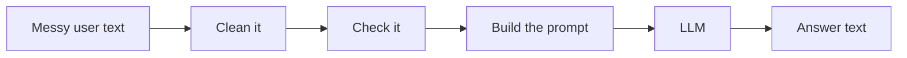

# Lesson 1.6: Working with Text (Strings)

**Course:** Python for AI · **Module 1:** Python Basics for GenAI and Agentic AI · **Updated:** Oct 2026

> **By the end:** You can clean, inspect, cut and format text, and build clean prompts from messy user input. This is the most-used Python skill in GenAI work.

---

## 1. Mental Model: In GenAI, Everything is Text

| What | Type |
|---|---|
| The user's question | `str` |
| Your prompt to the model | `str` |
| The model's answer | `str` |
| A document you feed the model | `str` |



**A string is a row of characters, each with a position number (index).**

```text
 text = "Python"
         P  y  t  h  o  n
 index:  0  1  2  3  4  5
 back:  -6 -5 -4 -3 -2 -1
```

---

## 2. Making Strings

```python
model = "gpt-6-astra"                  # double quotes
city = 'Faisalabad'                   # single quotes work the same
quote = "It's ready"              # mix them to use a quote inside
prompt = """You are a tutor.
Answer in 2 lines."""             # triple quotes = many lines
```

**Special characters:** `\n` new line, `\t` tab, `\\` backslash.

```python
print("Line 1\nLine 2")
```

---

## 3. Inspect: Length, Index, Slice

```python
text = "Python for AI"

print(len(text))      # 13  (spaces count)
print(text[0])        # P   (first)
print(text[-1])       # I   (last)
print(text[0:6])      # Python  (start included, end not)
print(text[:6])       # Python  (from the start)
print(text[-2:])      # AI      (last 2)
```

**Slice rule:** `text[start:end]` gives from `start` up to, but **not including**, `end`.

**AI use:** cut long text before sending it to a model: `short = document[:2000]`

---

## 4. The Methods You Will Use Every Day

A method is an action a string can do: `text.method()`.

| Method | Example | Result |
|---|---|---|
| `.strip()` | `"  hi  ".strip()` | `"hi"` (removes spaces at both ends) |
| `.lower()` | `"PYTHON".lower()` | `"python"` |
| `.upper()` | `"ai".upper()` | `"AI"` |
| `.title()` | `"ayesha khan".title()` | `"Ayesha Khan"` |
| `.capitalize()` | `"hello world".capitalize()` | `"Hello world"` |
| `.replace(a, b)` | `"gpt".replace("g", "G")` | `"Gpt"` |
| `.count(x)` | `"banana".count("a")` | `3` |
| `.find(x)` | `"Python".find("th")` | `2` (`-1` if not found) |
| `.startswith(x)` | `"/help".startswith("/")` | `True` |
| `.endswith(x)` | `"main.py".endswith(".py")` | `True` |

**Check if text contains something with `in`:**

```python
message = "I want a refund"
print("refund" in message)          # True
print("REFUND" in message)          # False (case matters)
print("refund" in message.lower())  # True (pro habit: lower first)
```

**Chain methods** (each one returns a new string):

```python
name = "   Ahmad KHAN  ".strip().title()
print(name)   # Ahmad Khan
```

---

## 5. Strings Never Change (Immutable)

```python
name = "ali"
name.upper()      # makes "ALI" but nobody keeps it
print(name)       # ali

name = name.upper()   # keep the result
print(name)           # ALI
```

**Mental model:** a method gives you a **new** string. Save it, or it is lost.

---

## 6. f-strings Like a Pro

```python
model = "gpt-6-luna"
cost = 1234.5678
tokens = 1500000

print(f"{model} cost {cost:.2f} PKR")    # 2 decimals: 1234.57
print(f"Tokens used: {tokens:,}")         # commas: 1,500,000
print(f"Model: {model.upper()}")          # methods work inside { }
print("=" * 30)                           # repeat: a 30-character line
```

**Multi-line prompt template (how real apps build prompts):**

```python
role = "customer support agent"
business = "Sweet Crumbs bakery"
question = "where is my order?"

prompt = f"""You are a friendly {role} for {business}.
Answer in 2 short sentences.
Customer question: {question}"""
print(prompt)
```

---

## 7. Mini Build: Prompt Cleaner

```python
"""Lesson 1.6: Clean a messy user message before it goes to an AI model."""

raw = input("Your question: ")

# Users add extra spaces and random capitals; models work better with clean text
clean = raw.strip().capitalize()

# Rule of thumb: 1 token is about 4 characters of English text
estimated_tokens = round(len(clean) / 4)

# Keep prompts short to save tokens (and money)
short = clean[:200]

prompt = f"You are a helpful Python tutor. Answer in 3 lines.\nQuestion: {short}"

print("=" * 40)
print(f"Cleaned: {clean}")
print(f"Characters: {len(clean)}, about {estimated_tokens} tokens")
print(f"Mentions Python: {'python' in clean.lower()}")
print("=" * 40)
print(prompt)
```

**Industry link:** every chatbot cleans input like this before the API call. Clean input means fewer wasted tokens and better answers.

---

## 8. Common Errors

| Error | Cause | Fix |
|---|---|---|
| `IndexError: string index out of range` | `text[50]` on a short string | Check `len(text)` first; slices like `text[:50]` never error |
| `SyntaxError: unterminated string literal` | Missing closing quote | Close every `"` and `'` |
| `TypeError: can only concatenate str (not "int") to str` | `"Tokens: " + 50` | Use an f-string |
| `TypeError: 'str' object does not support item assignment` | `name[0] = "A"` | Strings never change; build a new one |
| Method "did nothing" | `name.upper()` without saving | `name = name.upper()` |

---

## 9. Job & Client Angle

- **Prompt engineering is string work.** Building, cleaning and limiting prompts is a daily AI engineer task.
- **Text cleaning is a paid service.** Clients pay to clean names, phone numbers, product titles and reviews before feeding them to AI.
- **Tokens cost money.** Cutting long text with slicing keeps a client's monthly AI bill under control.

---

## 10. Your Task (self-create)

Build a **Prompt Cleaner** in `code/lesson_06_strings_prompts.py`: clean a messy name and question, estimate tokens, check whether the question mentions "python", and print a multi-line prompt with the question limited to 150 characters.

**Full requirements, expected output, stretch goal and marking:** [Task 1.6: Prompt Cleaner](../assessments/module-1/checkpoint-2-code-tasks.md#task-16-prompt-cleaner)

Run it with `uv run lesson_06_strings_prompts.py`, then push to GitHub.

---

## Key Takeaways

- In GenAI, **prompts and answers are strings**
- Index from **0**; `-1` is the last character; `text[start:end]` excludes `end`
- `.strip()`, `.lower()`, `.replace()` and `in` clean and check text
- Strings **never change**: save the result of a method
- f-strings format numbers: `{x:.2f}` and `{x:,}`

### Quick Check
1. What does `"Python for AI"[-2:]` return?
2. Why does `"Refund" in "i want a refund"` give `False`, and how do you fix it?
3. After `name = " ali "` and `name.strip()`, why does `print(len(name))` still show `5`?

---

## Must-Have Resources

- Python tutorial, text: https://docs.python.org/3/tutorial/introduction.html#text
- String methods reference: https://docs.python.org/3/library/stdtypes.html#string-methods
- f-strings guide (Real Python): https://realpython.com/python-f-strings
- Prompt engineering overview (Anthropic): https://docs.claude.com/en/docs/build-with-claude/prompt-engineering/overview

**Next:** Lesson 1.7: Operators and Making Decisions
