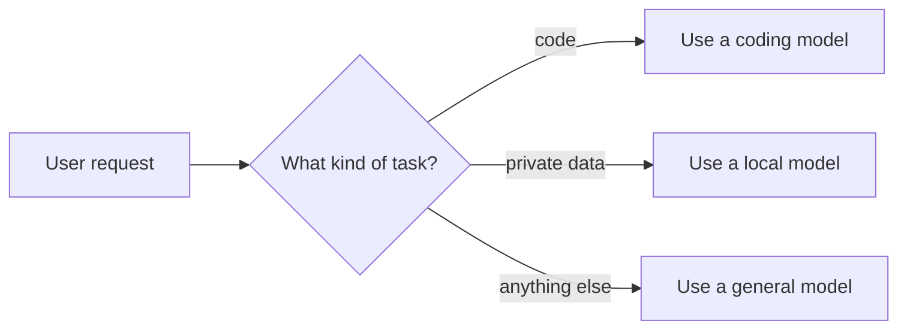
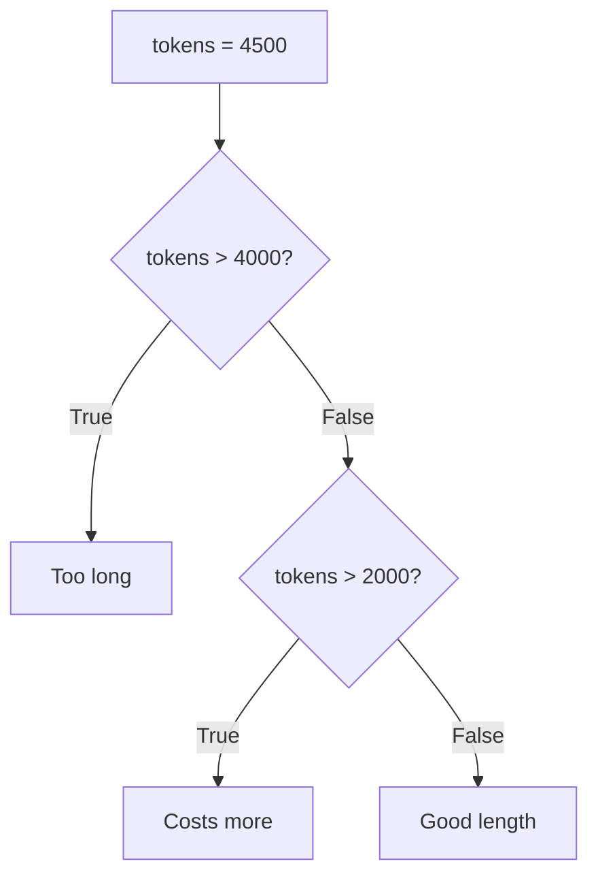

# Lesson 1.7: Operators and Making Decisions

**Course:** Python for AI · **Module 1:** Python Basics for GenAI and Agentic AI · **Updated:** Oct 2026

> **By the end:** You can calculate, compare and combine conditions, and make your program choose what to do with `if / elif / else`. This is the first step from a script to an agent that decides.

---

## 1. Mental Model: Decisions Turn Scripts into Agents

A script runs every line. A program with decisions **chooses** its path, like an agent choosing which tool to use.



Every decision is a **question with a True or False answer**.

---

## 2. Arithmetic Operators

| Operator | Meaning | Example | Result |
|---|---|---|---|
| `+` | Add | `100 + 50` | `150` |
| `-` | Subtract | `100 - 30` | `70` |
| `*` | Multiply | `4 * 250` | `1000` |
| `/` | Divide (always float) | `7 / 2` | `3.5` |
| `//` | Whole-number divide | `7 // 2` | `3` |
| `%` | Remainder | `7 % 2` | `1` |
| `**` | Power | `2 ** 10` | `1024` |

**Order:** `**` first, then `* / // %`, then `+ -`. Use brackets to be clear.

```python
print(2 + 3 * 4)     # 14
print((2 + 3) * 4)   # 20
```

**Shortcut assignment:**

```python
tokens_used = 100
tokens_used += 50    # same as tokens_used = tokens_used + 50
print(tokens_used)   # 150
```

**AI use:** `total_cost = tokens / 1000 * price` and `pages = total_chars // 2000`.

---

## 3. Comparison Operators (always give True or False)

| Operator | Meaning | Example | Result |
|---|---|---|---|
| `==` | Equal | `"bye" == "bye"` | `True` |
| `!=` | Not equal | `"gpt" != "claude"` | `True` |
| `>` / `<` | Greater / less | `500 > 300` | `True` |
| `>=` / `<=` | Greater or equal / less or equal | `0.7 <= 1.0` | `True` |

**Mental model:** `=` **stores** a value. `==` **asks** a question.

---

## 4. Logical Operators: Combine Questions

| Operator | True when | Example |
|---|---|---|
| `and` | Both are True | `tokens > 0 and tokens <= 4000` |
| `or` | At least one is True | `plan == "pro" or is_trainer` |
| `not` | Flips it | `not is_blocked` |

```python
temperature = 0.7
print(temperature >= 0 and temperature <= 1)   # True
print(0 <= temperature <= 1)                   # True (pro shortcut)
```

**Truthy and falsy:** empty values count as `False`: `""`, `0`, `0.0`, `None`. Everything else counts as `True`.

---

## 5. if / elif / else

```python
tokens = 4500

if tokens > 4000:
    print("Too long. Please shorten your message.")
elif tokens > 2000:
    print("Long message. This will cost more.")
else:
    print("Good length.")
```

| Rule | Why |
|---|---|
| End each condition line with `:` | Python needs it |
| Indent the body with **4 spaces** | Indentation is how Python knows what belongs to the `if` |
| Python checks from the top and runs **only the first** True block | Put the strictest condition first |
| `elif` and `else` are optional | Use only what you need |



---

## 6. Decisions on Text (Most Common in AI Apps)

```python
message = input("You: ").strip().lower()

if message == "bye":
    print("Bot: Goodbye!")
elif "refund" in message or "money back" in message:
    print("Bot: I will connect you to a human agent.")
elif message == "":
    print("Bot: Please type something.")
else:
    print("Bot: Let me think about that...")
```

**Pro habit:** clean the text first (`.strip().lower()`), then decide. Users type `"BYE "`, `"Bye"` and `"bye"`.

---

## 7. Mini Build: Smart Model Router

```python
"""Lesson 1.7: Pick the right AI model for a task, like an agent choosing a tool."""

task = input("Task (code / private / chat): ").strip().lower()
tokens = int(input("Estimated tokens: "))

# Private data must never leave the laptop, so check it first
if task == "private":
    model = "llama3.2 (local, Ollama)"
elif task == "code":
    model = "claude (cloud, strong at code)"
else:
    model = "small cloud model (cheap for chat)"

# Very long requests cost more, so warn before sending
if tokens > 4000:
    warning = "Long request: consider shortening it."
else:
    warning = "Length is fine."

print("=" * 40)
print(f"Chosen model: {model}")
print(warning)
```

**Industry link:** real AI products route requests like this: cheap models for easy work, strong models for hard work, local models for private data. In the agent modules, the model itself makes these choices.

---

## 8. Common Errors and Traps

| Problem | Cause | Fix |
|---|---|---|
| `SyntaxError: expected ':'` | Missing colon after `if` / `elif` / `else` | Add `:` |
| `IndentationError: expected an indented block` | Body not indented | Indent 4 spaces |
| `SyntaxError: invalid syntax` with `if x = 5:` | Used `=` instead of `==` | Use `==` to compare |
| `TypeError: '>' not supported between instances of 'str' and 'int'` | Compared `input()` text with a number | Convert with `int()` first |
| `if task == "code" or "chat":` is **always True** | `"chat"` alone is truthy | `if task == "code" or task == "chat":` |
| Wrong branch runs | A wide condition is above a strict one | Put the strictest condition first |

---

## 9. Job & Client Angle

- **Business rules are if/else.** "Free users get 10 messages", "Refund requests go to a human", "Orders over 5,000 PKR get free delivery": clients describe rules, you write conditions.
- **Model routing saves money.** Sending easy questions to a cheap model and hard ones to a strong model can cut a client's AI bill a lot.
- **Guardrails protect clients.** Checking input length, blocked words and private data before calling an AI is part of building a safe, client-ready app.

---

## 10. Your Task (self-create)

Build a **Smart Model Router** in `code/lesson_07_conditions.py`: send `code`, `private` and `chat` tasks to different models with `if / elif / else`, warn about long requests, and print the estimated cost (0 for the local model).

**Full requirements, expected output, stretch goal and marking:** [Task 1.7: Smart Model Router](../assessments/module-1/checkpoint-2-code-tasks.md#task-17-smart-model-router)

Run it with `uv run lesson_07_conditions.py`, then push to GitHub.

---

## Key Takeaways

- Arithmetic: `/` gives a float, `//` cuts the decimals, `%` gives the remainder
- `=` stores, `==` compares; comparisons give `True` or `False`
- Combine conditions with `and`, `or`, `not`
- `if / elif / else` runs **only the first** True block: strictest first
- Clean text before you decide; convert `input()` before you compare numbers

### Quick Check
1. What do `17 // 5` and `17 % 5` return?
2. Why is `if task == "code" or "chat":` always True? Write the fix.
3. `score = 85`. With `if score > 50:` above `elif score > 80:`, which message prints, and why?

---

## Must-Have Resources

- Python tutorial, if statements: https://docs.python.org/3/tutorial/controlflow.html#if-statements
- Operator precedence table: https://docs.python.org/3/reference/expressions.html#operator-precedence
- Truth value testing: https://docs.python.org/3/library/stdtypes.html#truth-value-testing
- Building effective agents (Anthropic), see "routing": https://www.anthropic.com/engineering/building-effective-agents

**Next:** Lesson 1.8: Mini Project: Rule-Based Chatbot
