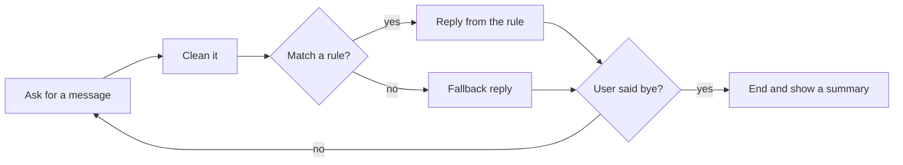

# Lesson 1.8: Mini Project: Rule-Based Chatbot

**Course:** Python for AI · **Module 1:** Python Basics for GenAI and Agentic AI · **Updated:** Oct 2026

> **By the end:** You have built a working chatbot for a real business using everything from Module 1, plus one new tool: the loop. You will see exactly where rules stop working, and why we need an LLM in Module 2.

---

## 1. Mental Model: A Chatbot is a Loop

Remember **Agent = LLM + Tools + Memory + Loop** from Lesson 1.1? Today you build the **Loop** and the **Memory**. The "brain" is your `if / elif` rules.



| | Rule-based bot (today) | LLM bot (Module 2) |
|---|---|---|
| How it answers | Your `if` rules | The model writes the answer |
| Cost | Free | Pays per token |
| Predictable | Always the same answer | Can vary, can hallucinate |
| New wording | Breaks easily | Understands it |

**Industry reality:** most real support bots are **hybrid**. Rules handle the fixed answers and safety checks, and the LLM handles everything else.

---

## 2. The One New Tool: `while True` and `break`

```python
while True:
    message = input("You: ").strip().lower()
    if message == "bye":
        print("Bot: Goodbye!")
        break                      # leave the loop
    print(f"Bot: You said '{message}'")
```

| Part | Meaning |
|---|---|
| `while True:` | Repeat the indented block forever |
| `break` | Stop the loop right now |
| Indentation | Everything indented 4 spaces belongs to the loop |

**Stuck in a loop that never ends?** Press `Ctrl + C` in the terminal.

---

## 3. Design First, Code Second

Professionals plan the bot with the client before coding. Pick a business and fill this table.

| Intent (what the user wants) | Keywords to look for | Reply |
|---|---|---|
| Complaint | refund, complaint, late | Hand over to a human |
| Opening hours | hour, open, time | 9 am to 10 pm |
| Prices | price, cost, how much | Price list |
| Location | where, location, address | Address |
| Ordering | order, delivery | WhatsApp number |
| Greeting | hi, hello, salam | Friendly hello |
| Exit | bye, exit | Goodbye and summary |
| Anything else | (no match) | Fallback |

**Order matters.** "My order is late" contains both "order" and "late". Put **complaints first** so the unhappy customer reaches a human, not the order menu.

---

## 4. Full Build: Sweet Crumbs Bakery Bot

```python
"""Lesson 1.8: Rule-based chatbot for Sweet Crumbs bakery (example business)."""

BOT = "Sweet Crumbs Bot"
print(f"{BOT}: Hi! I can help with hours, prices, location and orders. Type 'bye' to exit.")

# Memory: the bot remembers the user's name for the whole chat
name = input(f"{BOT}: What is your name? ").strip().title()
if name == "":
    name = "friend"
print(f"{BOT}: Nice to meet you, {name}!")

count = 0       # messages sent, to show the client how busy the bot is
unanswered = 0  # questions the rules could not answer: these show what to add next

while True:
    message = input(f"{name}: ").strip().lower()
    count += 1

    if message == "bye" or message == "exit":
        print(f"{BOT}: Goodbye, {name}! Thanks for visiting.")
        break
    elif message == "":
        print(f"{BOT}: Please type a question.")
    # Complaints first, so an unhappy customer always reaches a human
    elif "refund" in message or "complaint" in message or "late" in message:
        print(f"{BOT}: Sorry about that. A manager will call you within 1 hour.")
    elif "hour" in message or "open" in message or "time" in message:
        print(f"{BOT}: We are open 9 am to 10 pm, every day.")
    elif "price" in message or "cost" in message or "how much" in message:
        print(f"{BOT}: Cakes start at 1,500 PKR. Cupcakes are 250 PKR each.")
    elif "where" in message or "location" in message or "address" in message:
        print(f"{BOT}: We are on Main Boulevard, Lahore.")
    elif "order" in message or "delivery" in message:
        print(f"{BOT}: Order on WhatsApp. Delivery is free over 3,000 PKR.")
    # Exact match, because "hi" is hiding inside words like "this" and "which"
    elif message == "hi" or message == "hello" or message.startswith("salam"):
        print(f"{BOT}: Hello again, {name}! How can I help?")
    else:
        unanswered += 1
        prompt = f"You are the friendly assistant of Sweet Crumbs bakery. Answer in 2 lines: {message}"
        print(f"{BOT}: I am not sure yet. In Module 2, an AI will answer using this prompt:")
        print(f"  {prompt}")

print("=" * 40)
print(f"Chat summary: {count} messages, {unanswered} unanswered.")
```

**What you used from Module 1:** `input()` and `print()` (1.4), variables and `int` counters (1.5), `.strip().lower()`, `in` and f-strings (1.6), `if / elif / else` and `+=` (1.7).

---

## 5. Test Like a Pro

Before showing a client, try every rule **and** the tricky inputs.

| You type | Expected reply | Tests |
|---|---|---|
| `What are your HOURS?` | Opening hours | Capitals are handled |
| `   how much is a cake   ` | Prices | Extra spaces are handled |
| `my order is late` | Manager will call | Rule order (complaint first) |
| `which cake is best?` | Fallback with AI prompt | "hi" inside "which" does not fire |
| (just press Enter) | Please type a question | Empty input |
| `BYE` | Goodbye + summary | Exit works |

Every fallback is a **gap in your rules**. That list is exactly what an LLM will cover in Module 2.

---

## 6. Common Errors and Traps

| Problem | Cause | Fix |
|---|---|---|
| Bot never stops | No `break`, or `bye` check never matches | Clean with `.strip().lower()`, check `break`; press `Ctrl + C` to stop |
| `SyntaxError: 'break' outside loop` | `break` is not indented inside the `while` | Indent it under the loop |
| Greeting fires on "this", "which" | `"hi" in message` matches inside words | Use `==` or `.startswith()` for short words |
| Late order goes to the order menu | `order` rule is above the complaint rule | Put the most important rule first |
| Name is lost after one message | `name` asked inside the loop | Ask once, **before** the loop |

---

## 7. Job & Client Angle

- **FAQ bots are the #1 beginner AI gig.** Bakeries, clinics, tuition centres and shops all repeat the same 10 answers every day.
- **Sell the hybrid.** Rules for prices, hours and complaints (always correct), AI for everything else. Clients trust it more than a pure AI bot.
- **The summary is a selling point.** "Your customers asked 40 questions, 6 were unanswered" tells the client what to add next. Data like this turns one project into monthly work.

---

## 8. Your Task: Business Helper Bot (Module 1 Final)

Build a **Business Helper Bot** in `code/lesson_08_mini_chatbot.py` for a real local business (family shop, clinic, tuition centre, salon): design at least 5 intents first, then build the loop, the complaint-first rules, the fallback prompt and the exit summary.

**Full requirements, expected output, stretch goal and marking:** [Task 1.8: Business Helper Bot](../assessments/module-1/checkpoint-2-code-tasks.md#task-18-business-helper-bot-module-1-final)

Run every test from Section 5 on your bot, then push to GitHub.

---

## Key Takeaways

- A chatbot is a **loop**: ask, clean, decide, reply, repeat
- `while True` repeats; `break` exits
- Ask for memory (like the name) **before** the loop
- Rule order matters: **most important first**
- Rules are free and predictable but break on new wording. **LLMs fill the gaps** (Module 2)

### Quick Check
1. What does `break` do, and what happens without it in `while True`?
2. Why does `"hi" in "which cake?"` give `True`? How do you avoid it?
3. Why must the complaint rule come before the order rule?

---

## Must-Have Resources

- Python tutorial, while and break: https://docs.python.org/3/tutorial/controlflow.html#break-and-continue-statements-and-else-clauses-on-loops
- Building effective agents (Anthropic): https://www.anthropic.com/engineering/building-effective-agents
- Ollama (you will connect your bot to it in Module 2): https://ollama.com

**Checkpoint 2 reached (Lessons 1.5 to 1.8):** take [Quick Check 2](../assessments/module-1/checkpoint-2-quick-checks.md), then start the [AI Front Desk project](../assessments/module-1/checkpoint-2-project-front-desk.md), your Module 1 final.

**Next:** Module 2: Core Python for Building LLM Apps
