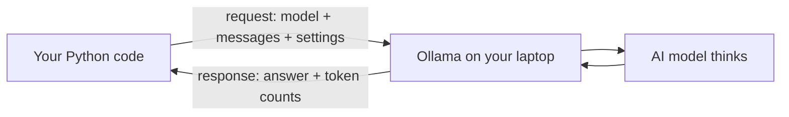
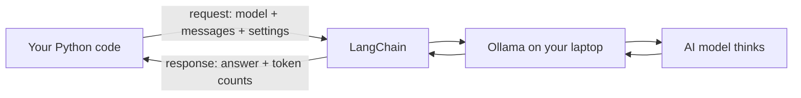

# Lesson 2.1: Your First AI Call

**Course:** Python for AI · **Module 2:** Core Python for Building LLM Apps · **Updated:** Oct 2026

> **By the end:** Your Python code sends a prompt to a real AI model through LangChain, gets the answer back, reads the token count, and controls the model's behaviour. Your Module 1 chatbot gets a real AI brain.

---

## 1. Mental Model: An API Call is a Letter and a Reply

**Calling Ollama directly (without LangChain):**



**Calling the model through LangChain:**



| Word | Meaning |
|---|---|
| **Library** | Code someone else wrote that you can use (`langchain`) |
| **LangChain** | A toolkit that talks to many AI providers (Ollama, Claude, OpenAI, Gemini) with the **same code** |
| **API call** | Your code asks another program to do something and waits for the reply |
| **Request** | What you send: your messages |
| **Response** | What comes back: the answer, plus extra info like tokens used |

Ollama runs a small server on your laptop at `http://localhost:11434`. LangChain talks to it for you. Nothing leaves your computer.

---

## 2. Setup (5 minutes)

**1. Make sure the Ollama app is running**, then download a model in the terminal:

```bash
ollama pull llama3.2       # about 2 GB, good for most laptops
ollama pull llama3.2:1b    # smaller and faster, for 8 GB RAM laptops
ollama list                # shows the models you have
```

**2. Add LangChain and its Ollama connector to your `python-ai` project:**

```bash
uv add langchain langchain-ollama
```

Open `pyproject.toml`: both are now under `dependencies`. That is how a client's laptop will know to install them too.

---

## 3. Your First AI Call (5 lines)

```python
from langchain.chat_models import init_chat_model

llm = init_chat_model("llama3.2", model_provider="ollama")

response = llm.invoke([{"role": "user", "content": "Explain Python in 2 lines for a beginner."}])
print(response.text)
```

```bash
uv run lesson_2_1_first_ai_call.py
```

| Line | What it does |
|---|---|
| `from langchain.chat_models import init_chat_model` | Bring the `init_chat_model` tool from LangChain into your file |
| `init_chat_model("llama3.2", model_provider="ollama")` | Create your model **once**: which model, and who runs it |
| `llm` | Short for "large language model": your connection to the AI |
| `llm.invoke([...])` | Send the request and **wait** for the answer |
| `[{"role": ..., "content": ...}]` | Your conversation. **Copy this shape for now**: lists come in Lesson 2.2, dictionaries in 2.3 |
| `response.text` | The AI's answer, as a normal `str` |

**The first call is slow** (the model loads into memory). The next calls are faster.

**Why LangChain?** To use Claude or OpenAI later, you change `model_provider` and the model name. The rest of your code stays the same.

---

## 4. What Else Comes Back

```python
print(response.response_metadata["model"])          # which model answered
print(response.usage_metadata["input_tokens"])      # tokens in your prompt
print(response.usage_metadata["output_tokens"])     # tokens in the answer
print(response.response_metadata["total_duration"]) # time in nanoseconds
```

The `["..."]` part reads a value by its name. You will master this in Lesson 2.3: **copy it for now**.

**Turn nanoseconds into seconds** (Lesson 1.7 maths):

```python
seconds = response.response_metadata["total_duration"] / 1_000_000_000
total_tokens = response.usage_metadata["total_tokens"]
print(f"{total_tokens} tokens in {seconds:.1f} seconds")
```

**Why it matters:** cloud AI companies charge **per token**. Counting tokens is how you estimate a client's bill.

---

## 5. Control the Model: System Message and Temperature

```python
tutor = init_chat_model("llama3.2", model_provider="ollama", temperature=0.2)

response = tutor.invoke([
    {"role": "system", "content": "You are a friendly tutor. Answer in 2 short lines."},
    {"role": "user", "content": "What is a variable?"},
])
print(response.text)
```

| Setting | What it does | Use for |
|---|---|---|
| `system` message | Sets the AI's role and rules for the whole chat | Personality, language, answer length |
| `temperature` low (0 to 0.3) | Focused, more repeatable answers | Facts, support, data extraction |
| `temperature` high (0.8 to 1.2) | Creative, more varied answers | Slogans, stories, ideas |

Temperature is set **when you create the model**. Need two settings? Create two models.

**Try it in class (predict, then run):**

```python
cold = init_chat_model("llama3.2", model_provider="ollama", temperature=0.0)
hot = init_chat_model("llama3.2", model_provider="ollama", temperature=1.0)
```

Run "Write a slogan for a bakery" 3 times with `cold`, then 3 times with `hot`. Predict first: which one gives 3 different slogans?

---

## 6. Wow Moment: Stream the Answer Word by Word

```python
for chunk in llm.stream([{"role": "user", "content": "Give 3 tips to learn Python."}]):
    print(chunk.text, end="", flush=True)  # for loops are explained in Lesson 2.4: copy this for now
print()
```

This is the "typing" effect you see in ChatGPT and Claude. The user sees the answer start immediately instead of waiting.

---

## 7. Mini Build: Your Module 1 Bot Gets a Real AI Brain

Remember the fallback in Lesson 1.8: *"In Module 2, an AI will answer using this prompt"*? Today is that day.

```python
"""Lesson 2.1: Sweet Crumbs bot: fixed rules first, AI for everything else."""

from langchain.chat_models import init_chat_model

SYSTEM = "You are the friendly assistant of Sweet Crumbs bakery in Lahore. Answer in 2 short lines."

# Create the model once, before the loop, so every question reuses it
llm = init_chat_model("llama3.2", model_provider="ollama", temperature=0.3)

print("Sweet Crumbs Bot: Ask me anything. Type 'bye' to exit.")

while True:
    message = input("You: ").strip()

    # Rules first: free, instant and always correct
    if message.lower() == "bye":
        print("Bot: Goodbye!")
        break
    elif "refund" in message.lower():
        print("Bot: A manager will call you within 1 hour.")
    else:
        # Everything the rules cannot answer goes to the AI
        response = llm.invoke([
            {"role": "system", "content": SYSTEM},
            {"role": "user", "content": message},
        ])
        print(f"Bot: {response.text}")
        print(f"     ({response.usage_metadata['output_tokens']} tokens)")
```

**Test it:** say "My name is Ali", then ask "What is my name?". The bot **forgets**. Each call only sees the one message you sent. In Lesson 2.2 you will give it memory.

---

## 8. Common Errors

| Error | Cause | Fix |
|---|---|---|
| `ModuleNotFoundError: No module named 'langchain'` | Library not added, or run without `uv` | `uv add langchain langchain-ollama`, then run with `uv run` |
| `ImportError: Initializing ChatOllama requires the langchain-ollama package` | Only `langchain` was added | `uv add langchain-ollama` |
| `httpx.ConnectError: [Errno 111] Connection refused` | The Ollama app is not running | Open the Ollama app (or run `ollama serve`), then try again |
| `ResponseError: model "llama3.2" not found` | Model not downloaded, or name typo | `ollama pull llama3.2`, check `ollama list` |
| First answer takes 20+ seconds | Model loading into memory | Normal. Use `llama3.2:1b` on slow laptops |
| Answer is wrong or made up | Hallucination | Lower the temperature, give clearer instructions, always check facts |

---

## 9. Job & Client Angle

- **API calls are the core skill of an AI engineer.** Every chatbot, agent and AI tool is built on the same request and response you wrote today.
- **One codebase, any provider.** With LangChain, moving a client from a free local model to Claude or OpenAI is a one-line change. Clients love that flexibility.
- **Local AI is a selling point.** Clinics, law firms and schools pay more for AI that never sends their data to the internet.
- **Token counts are money.** "This bot uses about 300 tokens per chat" is the first number a client asks about.

---

## 10. Your Task (self-create)

Build an **AI Tutor** in `code/lesson_2_1_first_ai_call.py`: ask for a topic and a level, set the AI's role with a system message, call the model with temperature `0.2`, and print the answer with its token count and time.

**Full requirements, expected output, stretch goal and marking:** [Task 2.1: AI Tutor](../assessments/module-2/checkpoint-1-code-tasks.md#task-21-ai-tutor)

Run it with `uv run lesson_2_1_first_ai_call.py`, then commit `pyproject.toml`, `uv.lock` and your file, and push.

---

## Key Takeaways

- An **API call** = send a request (messages), get a response (answer + info)
- `uv add langchain langchain-ollama` adds the libraries; `init_chat_model(...)` creates your model once
- `llm.invoke(messages)` asks; the answer is in `response.text`; tokens in `response.usage_metadata`
- **System message** sets the role; **temperature** controls creativity
- Each call is separate: the model **remembers nothing** unless you send the history (Lesson 2.2)

### Quick Check
1. Where is the AI's answer inside `response`?
2. You want the same factual answer every time. Low or high temperature?
3. Your code says `httpx.ConnectError: [Errno 111] Connection refused`. What is the first thing to check?

---

## Must-Have Resources

- LangChain + Ollama (ChatOllama): https://docs.langchain.com/oss/python/integrations/chat/ollama
- LangChain models guide: https://docs.langchain.com/oss/python/langchain/models
- Ollama model library: https://ollama.com/library
- Prompt engineering overview (Anthropic): https://docs.claude.com/en/docs/build-with-claude/prompt-engineering/overview

**Next:** Lesson 2.2: Chat History with Lists
