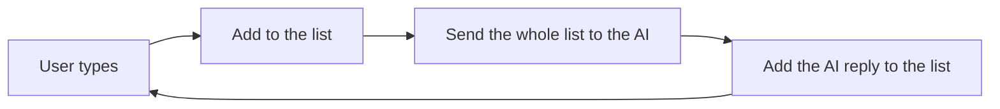

# Lesson 2.2: Chat History with Lists

**Course:** Python for AI · **Module 2:** Core Python for Building LLM Apps · **Updated:** Oct 2026

> **By the end:** You can store many values in a list, add and remove items, and give your chatbot a real memory. You will also see why long chats cost more, and how pros keep memory short.

---

## 1. Mental Model: The AI Has No Memory. You Are the Memory.

In Lesson 2.1 the bot forgot your name. That is not a bug: **every API call starts from zero**. The model only knows what you send in **that** call.

So apps keep a **list of every message** and send the whole list each time.



| Without history | With history |
|---|---|
| You: My name is Ali | You: My name is Ali |
| You: What is my name? | You: What is my name? |
| Bot: I don't know your name. | Bot: Your name is Ali. |

This is the **Memory** in **Agent = LLM + Tools + Memory + Loop**.

---

## 2. Lists: Many Values, One Variable

```python
models = ["llama3.2", "qwen3", "claude"]
```

A list is an **ordered row of items**. It works like a string: same indexes, same slices.

```python
print(models[0])      # llama3.2   (first)
print(models[-1])     # claude     (last)
print(models[0:2])    # ['llama3.2', 'qwen3']
print(len(models))    # 3
print("qwen3" in models)  # True
```

```text
 models = ["llama3.2", "qwen3", "claude"]
 index:        0          1        2
 back:        -3         -2       -1
```

A list can hold any type, even other lists: `scores = [8, 9.5, True, "done"]`.

---

## 3. Change a List

| Action | Code | `models` after |
|---|---|---|
| Start | `models = ["llama3.2", "qwen3"]` | `['llama3.2', 'qwen3']` |
| Add to the end | `models.append("claude")` | `['llama3.2', 'qwen3', 'claude']` |
| Insert at a position | `models.insert(0, "gemma3")` | `['gemma3', 'llama3.2', 'qwen3', 'claude']` |
| Replace an item | `models[1] = "llama3.2:1b"` | `['gemma3', 'llama3.2:1b', 'qwen3', 'claude']` |
| Remove by value | `models.remove("qwen3")` | `['gemma3', 'llama3.2:1b', 'claude']` |
| Remove the last and keep it | `last = models.pop()` | `['gemma3', 'llama3.2:1b']`, `last` is `'claude'` |
| Join two lists | `models + ["phi4"]` | a new list with `'phi4'` at the end |

**Big difference from strings:** string methods give you a **new** string (Lesson 1.6). List methods like `.append()` **change the list itself**.

```python
history = []
history.append("hi")       # changes history: do NOT write history = history.append(...)
print(history)             # ['hi']
```

---

## 4. The Messages List

In Lesson 2.1 you copied this shape. Now you can read it: **a list of messages**, oldest first.

```python
messages = [
    {"role": "system", "content": "You are a friendly tutor. Answer in 2 lines."},
    {"role": "user", "content": "My name is Ali."},
    {"role": "assistant", "content": "Nice to meet you, Ali!"},
    {"role": "user", "content": "What is my name?"},
]
print(len(messages))        # 4
print(messages[-1])         # the newest message
```

| Role | Who | Where |
|---|---|---|
| `system` | Your rules for the AI | Always first, only once |
| `user` | The person typing | Every question |
| `assistant` | The AI's reply | Every answer, so it remembers what it said |

Each message is a **dictionary** (`{"role": ..., "content": ...}`). You will master dictionaries in Lesson 2.3. `llm.invoke(messages)` accepts this list directly.

---

## 5. Memory Costs Tokens: Keep It Short

Every turn you send **all** past messages, so each call is bigger than the last.

| Turn | Messages sent | Tokens sent (example) |
|---|---|---|
| 1 | 2 | 40 |
| 5 | 10 | 250 |
| 20 | 40 | 1,100 |

Long chats get **slower, more expensive**, and can overflow the model's **context window**.

**Pro fix with slicing:** keep the system message plus only the newest messages.

```python
MAX_MESSAGES = 6
messages = [messages[0]] + messages[-MAX_MESSAGES:]
```

`[messages[0]]` keeps the system message (inside a list so the two lists can join), and `messages[-6:]` keeps the newest 6.

---

## 6. Mini Build: The Bakery Bot Remembers

```python
"""Lesson 2.2: Sweet Crumbs bot with memory, using a list of messages."""

from langchain.chat_models import init_chat_model

MAX_MESSAGES = 6  # keep memory short so the chat stays fast and cheap

llm = init_chat_model("llama3.2", model_provider="ollama")

messages = [
    {"role": "system", "content": "You are the friendly assistant of Sweet Crumbs bakery in Lahore. Answer in 2 short lines."},
]

print("Sweet Crumbs Bot: Ask me anything. Commands: /reset, bye")

while True:
    text = input("You: ").strip()

    if text.lower() == "bye":
        print("Bot: Goodbye!")
        break
    elif text.lower() == "/reset":
        messages = [messages[0]]  # forget the chat, keep the rules
        print("Bot: Memory cleared.")
    elif text == "":
        print("Bot: Please type a question.")
    else:
        messages.append({"role": "user", "content": text})

        # Trim old messages but always keep the system message first
        messages = [messages[0]] + messages[1:][-MAX_MESSAGES:]

        response = llm.invoke(messages)
        answer = response.text

        # Save the reply too, or the AI forgets what it said
        messages.append({"role": "assistant", "content": answer})

        print(f"Bot: {answer}")
        print(f"     (memory: {len(messages)} messages, {response.usage_metadata['input_tokens']} tokens sent)")
```

**Memory test (do it in class):**
1. `My name is Ali and I love chocolate`
2. `What cake do you suggest for me?`
3. `What is my name?`
4. `/reset`, then `What is my name?` again

Watch the "tokens sent" number grow each turn, then drop after `/reset`.

---

## 7. Common Errors and Traps

| Problem | Cause | Fix |
|---|---|---|
| `AttributeError: 'NoneType' object has no attribute 'append'` | `messages = messages.append(x)` | `.append()` returns nothing. Just write `messages.append(x)` |
| `IndexError: list index out of range` | `models[5]` on a short list | Check `len()` first. Slices never error |
| `ValueError: list.remove(x): x not in list` | Removing an item that is not there | Check with `in` before `.remove()` |
| Bot still forgets | AI reply not appended, or list re-created inside the loop | Create the list **before** the loop, append **both** user and assistant messages |
| Bot loses its personality | Trimming cut off the system message | Always rebuild with `[messages[0]] + ...` |
| Chat gets very slow | History grows forever | Trim with a slice, or offer `/reset` |

---

## 8. Job & Client Angle

- **Memory is the #1 thing clients notice.** A bot that forgets the customer's order number two messages later loses trust instantly.
- **Memory is a cost decision.** "We keep the last 6 messages" is a real design choice that keeps a client's monthly bill predictable.
- **Lists are everywhere in AI work:** chat histories, batches of documents, search results and lists of tools for an agent.

---

## 9. Your Task (self-create)

Build a **Personal Tutor with Memory** in `code/lesson_2_2_chat_memory.py`: a chat loop that keeps a `messages` list, remembers the conversation, supports `/reset` and `/count`, keeps memory short, and shows the tokens sent each turn.

**Full requirements, expected output, stretch goal and marking:** [Task 2.2: Personal Tutor with Memory](../assessments/module-2/checkpoint-1-code-tasks.md#task-22-personal-tutor-with-memory)

Run the memory test from Section 6, then push to GitHub.

---

## Key Takeaways

- The AI **remembers nothing** between calls; **you** send the history every time
- A **list** holds many items in order: index, slice, `len()` and `in` work like strings
- `.append()`, `.insert()`, `.remove()` and `.pop()` **change the list itself**
- Chat history = a list of messages with roles: **system, user, assistant**
- Long history costs tokens: keep `[messages[0]] + messages[-N:]`

### Quick Check
1. What is `["a", "b", "c"][-1]`?
2. Why does `messages = messages.append(msg)` break your bot?
3. Why must the assistant's reply be added to `messages` as well?

---

## Must-Have Resources

- Python tutorial, lists: https://docs.python.org/3/tutorial/introduction.html#lists
- More on lists: https://docs.python.org/3/tutorial/datastructures.html#more-on-lists
- LangChain messages: https://docs.langchain.com/oss/python/langchain/messages

**Next:** Lesson 2.3: Messages are Dictionaries
