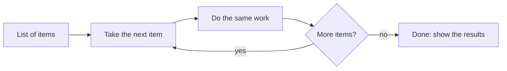

# Lesson 2.4: Loops that Talk

**Course:** Python for AI · **Module 2:** Core Python for Building LLM Apps · **Updated:** Oct 2026

> **By the end:** You can repeat work over lists, numbers and dictionaries, add up totals, and make the AI process a whole batch of items in one run. You will also test your rule bot against your AI bot, the way companies test AI before launch.

---

## 1. Mental Model: A Loop is a Conveyor Belt

Put items on the belt, and the same machine works on each one, one at a time.



| Loop | Use when | Example |
|---|---|---|
| `for` | You **know what to go through**: a list, a dictionary, a range of numbers | Write a description for each of 20 products |
| `while` | You repeat **until something happens** | Chat until the user types `bye` |

---

## 2. `for` Loops over Lists

```python
models = ["llama3.2", "qwen3", "gemma3"]

for model in models:
    print(f"Testing {model}...")
```

`model` is a new variable that holds **one item per round**. The indented block runs once for each item.

**Numbered lists with `enumerate`:**

```python
for number, model in enumerate(models, start=1):
    print(f"{number}. {model}")
# 1. llama3.2
# 2. qwen3
# 3. gemma3
```

**Repeat a number of times with `range`:**

```python
for i in range(3):          # 0, 1, 2  (stops before 3)
    print(f"Attempt {i + 1}")

print(list(range(1, 6)))    # [1, 2, 3, 4, 5]
```

---

## 3. Loop over a Dictionary

```python
prices = {"chocolate cake": 1500, "cupcake": 250, "brownie": 300}

for item, price in prices.items():
    print(f"{item.title()}: {price} PKR")
```

| Loop | Gives you |
|---|---|
| `for key in prices:` | Keys only |
| `for value in prices.values():` | Values only |
| `for key, value in prices.items():` | Both, in pairs |

**Loop over your chat history** (a list of dictionaries):

```python
for message in messages:
    print(f"{message['role']}: {message['content']}")
```

---

## 4. Patterns You Will Use Every Day

**Add up a total (accumulator):**

```python
total = 0
for price in prices.values():
    total += price
print(f"Total: {total} PKR")      # Total: 2050 PKR
```

**Collect results into a new list:**

```python
cheap = []
for item, price in prices.items():
    if price < 1000:
        cheap.append(item)
print(cheap)                      # ['cupcake', 'brownie']
```

**Skip or stop:**

```python
for item, price in prices.items():
    if price == 0:
        continue                  # skip this item, go to the next
    if item == "stop":
        break                     # leave the loop completely
    print(item)
```

**`while` with a real condition** (not just `True`):

```python
attempts = 0
while attempts < 3:
    attempts += 1
    print(f"Trying to reach the AI, attempt {attempts}")
```

**Remember Lesson 2.1?** Streaming used a `for` loop. Now you can read it: for each small piece of the answer, print it.

```python
for chunk in llm.stream(messages):
    print(chunk.text, end="", flush=True)
```

---

## 5. Mini Build: Batch Product Writer

One loop, many AI calls. This is how businesses turn a price list into a whole menu of descriptions in one run.

```python
"""Lesson 2.4: Write a short AI description for every product in one run."""

from langchain.chat_models import init_chat_model

# A little creative (0.7) is good for marketing text; create the model once, outside the loop
writer = init_chat_model("llama3.2", model_provider="ollama", temperature=0.7)
products = {"chocolate cake": 1500, "cupcake": 250, "brownie": 300, "old stock": 0, "donut": 200}

results = []
total_tokens = 0
total_seconds = 0

for name, price in products.items():
    # Items with no price are not for sale, so do not spend tokens on them
    if price == 0:
        print(f"Skipping {name} (no price)")
        continue

    prompt = f"Write one tempting sentence (max 15 words) for '{name}' at {price} PKR, for a Lahore bakery menu."
    response = writer.invoke([{"role": "user", "content": prompt}])

    results.append({"item": name, "price": price, "text": response.text.strip()})
    total_tokens += response.usage_metadata["total_tokens"]
    total_seconds += response.response_metadata["total_duration"] / 1_000_000_000

print("=" * 50)
for number, row in enumerate(results, start=1):
    print(f"{number}. {row['item'].title()} ({row['price']} PKR)")
    print(f"   {row['text']}")
print("=" * 50)
print(f"{len(results)} descriptions, {total_tokens} tokens, {total_seconds:.1f} seconds")
```

---

## 6. Class Activity: Bot Battle

Run the **same questions** through your Lesson 1.8 rules and through the AI. This is a mini **evaluation**: how companies test a bot before customers see it.

```python
"""Lesson 2.4: Bot battle: rules vs AI on the same test questions."""

from langchain.chat_models import init_chat_model

llm = init_chat_model("llama3.2", model_provider="ollama")

questions = [
    "What are your hours?",
    "How much is a cupcake?",
    "Do you have sugar-free options?",
    "Can I order a cake for 20 people?",
]

rule_misses = 0

for q in questions:
    text = q.lower()
    if "hour" in text:
        rule_answer = "We are open 9 am to 10 pm."
    elif "how much" in text or "price" in text:
        rule_answer = "Cupcakes are 250 PKR."
    else:
        rule_answer = "(no rule)"
        rule_misses += 1

    response = llm.invoke([
        {"role": "system", "content": "You are a bakery assistant. Hours 9 am to 10 pm. Cupcake 250 PKR. Answer in 1 line."},
        {"role": "user", "content": q},
    ])

    print(f"Q: {q}")
    print(f"   Rules: {rule_answer}")
    print(f"   AI:    {response.text.strip()}")

print(f"Rules could not answer {rule_misses} of {len(questions)} questions.")
```

**Discuss:** where did the rules win (always correct, free)? Where did the AI win? Did the AI make anything up?

---

## 7. Common Errors and Traps

| Problem | Cause | Fix |
|---|---|---|
| `IndentationError: expected an indented block` | Nothing indented under `for` | Indent the body 4 spaces |
| `TypeError: 'int' object is not iterable` | `for i in len(items):` | Loop the list itself, or use `range(len(items))` |
| `ValueError: too many values to unpack` | `for k, v in prices:` (no `.items()`) | `for k, v in prices.items():` |
| Loop never ends | `while` condition never becomes False | Change the counter inside the loop (`attempts += 1`) |
| Total is wrong | Accumulator reset **inside** the loop | Set `total = 0` **before** the loop |
| `range(5)` stops at 4 | The end number is not included | `range(1, 6)` for 1 to 5 |

---

## 8. Job & Client Angle

- **Batch work is where AI saves the most money.** 500 product descriptions, 1,000 customer reviews summarised, 200 CVs screened: one loop, overnight.
- **Always report totals.** "500 items, 41,000 tokens, 12 minutes" tells the client the cost and speed before they scale up.
- **Testing bots with question lists is an industry skill** (often called "evals"). A bot battle is a client-ready way to prove your bot works.

---

## 9. Your Task (self-create)

Build a **Batch Product Writer** in `code/lesson_2_4_batch_writer.py` for your own business: one loop that writes an AI description for every product, skips items with no price, and reports the total tokens and time.

**Full requirements, expected output, stretch goal and marking:** [Task 2.4: Batch Product Writer](../assessments/module-2/checkpoint-1-code-tasks.md#task-24-batch-product-writer)

Run it with `uv run lesson_2_4_batch_writer.py`, then push to GitHub.

---

## Key Takeaways

- `for` goes through **each item**; `while` repeats **until** a condition changes
- `enumerate()` numbers items; `range()` repeats a set number of times (end not included)
- Loop a dictionary with `.items()` to get keys and values together
- Accumulate totals and collect results **outside** the loop, update them **inside**
- `continue` skips one item; `break` stops the loop

### Quick Check
1. What does `list(range(2, 5))` give?
2. Why does `for k, v in prices:` fail, and what is the fix?
3. In the batch writer, why is `results = []` written before the loop and not inside it?

---

## Must-Have Resources

- Python tutorial, for statements and range: https://docs.python.org/3/tutorial/controlflow.html#for-statements
- Looping techniques (enumerate, items): https://docs.python.org/3/tutorial/datastructures.html#looping-techniques
- LangChain models (invoke and stream): https://docs.langchain.com/oss/python/langchain/models

**Checkpoint 1 reached (Lessons 2.1 to 2.4):** take [Quick Check 1](../assessments/module-2/checkpoint-1-quick-checks.md), then start the [AI Content Studio project](../assessments/module-2/checkpoint-1-project-content-studio.md).

**Next:** Lesson 2.5: Functions = Reusable AI Skills
