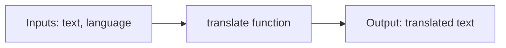

# Lesson 2.5: Functions = Reusable AI Skills

**Course:** Python for AI · **Module 2:** Core Python for Building LLM Apps · **Updated:** Oct 2026

> **By the end:** You can write functions with inputs, defaults and return values, document and test them, and turn repeated AI calls into reusable "skills" like `summarize()` and `translate()`. Functions are also what agent tools are made of (Lesson 2.8).

---

## 1. Mental Model: A Function is a Recipe Card

Write the recipe **once**, give it a name, and use it whenever you need it. You give it ingredients (**inputs**), it gives you back a dish (**output**).



Look back at Lessons 2.1 to 2.4: you wrote `llm.invoke([...])` and `response.text` again and again. That is the signal for a function.

| Without functions | With functions |
|---|---|
| The same 5 lines copied into every file | Written once: `summarize(text)` |
| Fix a bug in 10 places | Fix it in 1 place |
| Hard to read: what does this block do? | The name says it: `translate(review, "Urdu")` |

---

## 2. Define, Call, Return

```python
def estimate_tokens(text: str) -> int:
    """Estimate tokens: about 4 characters of English text per token."""
    return round(len(text) / 4)


print(estimate_tokens("Hello AI"))                      # 2
print(estimate_tokens("Explain Python to a beginner"))  # 7
```

| Part | Meaning |
|---|---|
| `def` | "Define a function" |
| `estimate_tokens` | Its name: `snake_case`, a verb or clear action |
| `(text: str)` | Its **parameter**: the input it expects, with a type hint (Lesson 1.5) |
| `-> int` | What it gives back |
| `"""docstring"""` | One line saying what it does. Teammates, clients and AI agents read this |
| `return` | Send the result back and **stop** the function |
| `estimate_tokens("Hello AI")` | **Calling** it: the code inside runs now, with `text = "Hello AI"` |

**Define before you call.** Python reads top to bottom, so the `def` must come first.

---

## 3. Parameters, Arguments and Defaults

```python
def build_prompt(task: str, audience: str = "beginners", lines: int = 3) -> str:
    """Build a clear prompt with an audience and a length limit."""
    return f"{task} for {audience} in {lines} lines."


print(build_prompt("Explain loops"))
# Explain loops for beginners in 3 lines.
print(build_prompt("Explain loops", "kids"))
# Explain loops for kids in 3 lines.
print(build_prompt("Explain loops", lines=2))
# Explain loops for beginners in 2 lines.
```

| Word | Meaning |
|---|---|
| **Parameter** | The name in the `def` line: `task`, `audience` |
| **Argument** | The value you pass in the call: `"Explain loops"` |
| **Default** | `audience: str = "beginners"`: used when you do not pass one |
| **Keyword argument** | `lines=2`: pass by name, skip the ones in between |

**Rule:** parameters **with** defaults come **after** the ones without.

---

## 4. `return` vs `print`: the Number One Beginner Trap

```python
def greet_print(name: str):
    print(f"Hi {name}")       # shows text, gives back nothing


def greet_return(name: str) -> str:
    return f"Hi {name}"       # gives the text back to your code


result = greet_print("Ali")   # prints: Hi Ali
print(result)                 # None

result = greet_return("Ali")  # prints nothing yet
print(result)                 # Hi Ali
```

| `print()` | `return` |
|---|---|
| Shows text to a human | Hands a value back to your code |
| The function gives back `None` | You can save it, check it, pass it on |

**Pro habit:** functions **return**; the main part of your program **prints**.

---

## 5. Scope: What a Function Can See

```python
PRICE_PER_1K = 0.5   # created outside: every function can read it


def estimate_cost(tokens: int) -> float:
    """Estimate the cost of a chat in PKR."""
    cost = tokens / 1000 * PRICE_PER_1K   # cost exists only inside this function
    return round(cost, 2)


print(estimate_cost(1500))   # 0.75
print(cost)                  # NameError: name 'cost' is not defined
```

Variables made **inside** a function disappear when it returns. To use a result outside, **return** it.

---

## 6. Test Your Functions

A small function is easy to test. `assert` checks that something is True and stops with an `AssertionError` if it is not.

```python
assert estimate_tokens("Hello AI") == 2
assert build_prompt("Explain loops", lines=2) == "Explain loops for beginners in 2 lines."
assert estimate_cost(1500) == 0.75
print("All tests passed")
```

**Why it matters:** when you change a function later, your tests tell you instantly if you broke something. Clients trust code that has tests.

---

## 7. AI Skills: Functions That Call the Model

Create the models **once**, at the top. Every skill reuses them.

```python
from langchain.chat_models import init_chat_model

# Two models, created once: precise for facts, creative for marketing text
precise = init_chat_model("llama3.2", model_provider="ollama", temperature=0.2)
creative = init_chat_model("llama3.2", model_provider="ollama", temperature=0.8)


def ask_ai(prompt: str, system: str = "You are a helpful assistant. Answer in 2 short lines.", creative_mode: bool = False) -> str:
    """Send one prompt to the AI and return its answer as text."""
    if creative_mode:
        llm = creative
    else:
        llm = precise
    response = llm.invoke([
        {"role": "system", "content": system},
        {"role": "user", "content": prompt},
    ])
    return response.text


def summarize(text: str, max_words: int = 30) -> str:
    """Summarize text in at most max_words words."""
    return ask_ai(f"Summarize in at most {max_words} words:\n{text}")


def translate(text: str, language: str = "Urdu") -> str:
    """Translate text into another language."""
    return ask_ai(f"Translate into {language}. Reply with the translation only:\n{text}")


def reply_to_review(review: str, business: str) -> str:
    """Write a short, polite reply from the business to a customer review."""
    return ask_ai(f"Write a 2-line polite reply from {business} to this review:\n{review}", creative_mode=True)
```

Now one line does the whole job:

```python
print(summarize("Our bakery opened in 2019 in Lahore. We bake fresh every morning ..."))
print(translate("Your order is ready for pickup."))
print(reply_to_review("Cake was great but delivery was late.", "Sweet Crumbs"))
```

**Mental model:** `ask_ai()` is the engine; `summarize()`, `translate()` and `reply_to_review()` are skills built on top. In Lesson 2.8, functions like these become **tools** an agent chooses by itself.

---

## 8. Mini Build: AI Skills Toolkit

```python
"""Lesson 2.5: AI Skills Toolkit: one menu, many reusable AI skills."""

from langchain.chat_models import init_chat_model

BUSINESS = "Sweet Crumbs"

precise = init_chat_model("llama3.2", model_provider="ollama", temperature=0.2)
creative = init_chat_model("llama3.2", model_provider="ollama", temperature=0.8)


def estimate_tokens(text: str) -> int:
    """Estimate tokens: about 4 characters of English text per token."""
    return round(len(text) / 4)


def ask_ai(prompt: str, system: str = "You are a helpful assistant. Answer in 2 short lines.", creative_mode: bool = False) -> str:
    """Send one prompt to the AI and return its answer as text."""
    if creative_mode:
        llm = creative
    else:
        llm = precise
    response = llm.invoke([
        {"role": "system", "content": system},
        {"role": "user", "content": prompt},
    ])
    return response.text


def summarize(text: str, max_words: int = 30) -> str:
    """Summarize text in at most max_words words."""
    return ask_ai(f"Summarize in at most {max_words} words:\n{text}")


def translate(text: str, language: str = "Urdu") -> str:
    """Translate text into another language."""
    return ask_ai(f"Translate into {language}. Reply with the translation only:\n{text}")


def reply_to_review(review: str, business: str) -> str:
    """Write a short, polite reply from the business to a customer review."""
    return ask_ai(f"Write a 2-line polite reply from {business} to this review:\n{review}", creative_mode=True)


# Quick tests for the function that does not need the AI
assert estimate_tokens("Hello AI") == 2

usage = {"summarize": 0, "translate": 0, "reply": 0}  # count how often each skill is used

print(f"{BUSINESS} AI Toolkit. Commands: /summarize, /translate, /reply, bye")

while True:
    command = input("Command: ").strip().lower()

    if command == "bye":
        break
    elif command == "/summarize":
        text = input("Text to summarize: ")
        print(f"AI: {summarize(text)}")
        usage["summarize"] += 1
    elif command == "/translate":
        text = input("Text to translate: ")
        language = input("Language (Enter for Urdu): ").strip()
        # An empty answer means "use the default", so we leave the argument out
        if language == "":
            print(f"AI: {translate(text)}")
        else:
            print(f"AI: {translate(text, language)}")
        usage["translate"] += 1
    elif command == "/reply":
        review = input("Customer review: ")
        print(f"AI: {reply_to_review(review, BUSINESS)}")
        print(f"    (review was about {estimate_tokens(review)} tokens)")
        usage["reply"] += 1
    else:
        print("Unknown command. Try /summarize, /translate, /reply or bye.")

print("Skills used today:")
for skill, count in usage.items():
    print(f"  {skill}: {count}")
```

**Try it in class:** reply to the same review three times with `/reply`. Because `reply_to_review` uses the creative model, each reply should be a little different. Then `/translate` the best reply into Urdu.

---

## 9. Common Errors and Traps

| Problem | Cause | Fix |
|---|---|---|
| `NameError: name 'summarize' is not defined` | Called before the `def`, or a typo in the name | Define functions at the top, check the spelling |
| `TypeError: translate() missing 1 required positional argument: 'text'` | Called without a required input | Pass every parameter that has no default |
| `SyntaxError: parameter without a default follows parameter with a default` | `def f(a="x", b):` | Put parameters with defaults last |
| `None` printed, or `TypeError: ... 'NoneType'` | The function prints instead of returning | `return` the value |
| `<function summarize at 0x...>` printed | Forgot the brackets: `print(summarize)` | Call it: `summarize(text)` |
| `NameError` for a variable made inside a function | Variables inside a function disappear after it returns | `return` the value and save it outside |
| `AssertionError` | A test failed: the function does not do what you expected | Read the function again, fix it, rerun the tests |

---

## 10. Job & Client Angle

- **Build your own skills library.** `summarize`, `translate` and `reply_to_review` work for every client. Write them once, reuse them in every project, and deliver faster.
- **Functions are agent tools.** In Lesson 2.8 the model chooses between your functions by reading their names and docstrings, so clear names and docstrings are now a paid skill.
- **Tested functions build trust.** "Every function has a test" is how you show a client the code is reliable.

---

## 11. Your Task (self-create)

Build an **AI Skills Toolkit** in `code/lesson_2_5_ai_skills.py` for your own business: an `ask_ai()` engine, at least three skills built on it, one function with a test that needs no AI, and a menu loop that counts how often each skill is used.

**Full requirements, expected output, stretch goal and marking:** [Task 2.5: AI Skills Toolkit](../assessments/module-2/checkpoint-2-code-tasks.md#task-25-ai-skills-toolkit)

Run it with `uv run lesson_2_5_ai_skills.py`, then push to GitHub.

---

## Key Takeaways

- A **function** is a named recipe: `def name(parameters) -> type:`, a docstring, then `return`
- **Defaults** make inputs optional; keyword arguments (`lines=2`) skip the ones in between
- Functions **return** values; the main program **prints** them
- Variables inside a function are **local**: return what you need
- `ask_ai()` is the engine; skills like `summarize()` are built on it, and they become agent tools in Lesson 2.8

### Quick Check
1. What does a function give back if it has no `return`?
2. Why must `def f(a="x", b):` be rewritten?
3. Why are the models created once at the top instead of inside `ask_ai()`?

---

## Must-Have Resources

- Python tutorial, defining functions: https://docs.python.org/3/tutorial/controlflow.html#defining-functions
- More on defining functions (defaults, keyword arguments): https://docs.python.org/3/tutorial/controlflow.html#more-on-defining-functions
- Docstring conventions (PEP 257): https://peps.python.org/pep-0257/
- Defining your own functions (Real Python): https://realpython.com/defining-your-own-python-function/

**Next:** Lesson 2.6: Files, JSON and Errors
