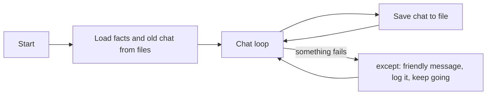

# Lesson 2.6: Files, JSON and Errors

**Course:** Python for AI · **Module 2:** Core Python for Building LLM Apps · **Updated:** Oct 2026

> **By the end:** Your bot loads business facts from a file the owner can edit, saves every chat so it survives a restart, and keeps working when things go wrong instead of crashing. That is the difference between a demo and a product.

---

## 1. Mental Model: Whiteboard, Notebook and Seatbelt

| | What it is | In your app |
|---|---|---|
| **Variables** | A whiteboard: wiped when the program ends | `messages` disappears when you close the bot |
| **Files** | A notebook: still there tomorrow | `chat_history.json` remembers yesterday's chat |
| **try / except** | A seatbelt: the crash happens, but you survive it | "Ollama is off" becomes a polite message, not a red error |



---

## 2. Text Files: Write, Add, Read

```python
with open("notes.txt", "w", encoding="utf-8") as f:
    f.write("Lesson 2.6 notes\n")

with open("notes.txt", "a", encoding="utf-8") as f:
    f.write("JSON = dictionaries saved in a file\n")

with open("notes.txt", encoding="utf-8") as f:
    text = f.read()
print(text)
```

| Mode | Meaning | Careful |
|---|---|---|
| `"r"` (default) | Read | File must exist |
| `"w"` | Write | **Erases** the old content first |
| `"a"` | Append | Adds to the end, keeps old content (perfect for logs) |

| Part | Why |
|---|---|
| `with open(...) as f:` | Opens the file and **closes it automatically** when the block ends |
| `encoding="utf-8"` | Handles Urdu and every language. Without it, Windows can break on non-English text |
| `"\n"` | `write()` does not add a new line for you |

**Read line by line** (Lesson 2.4 loops):

```python
with open("notes.txt", encoding="utf-8") as f:
    for line in f:
        print(f"> {line.strip()}")
```

**Paths are relative to the folder you run from.** If you run `cd code` then `uv run lesson.py`, `"notes.txt"` is created inside `code/`.

---

## 3. JSON: Lists and Dictionaries in a File

JSON is the language of AI APIs and configs. It looks almost exactly like Python dictionaries and lists.

```python
import json

order = {"customer": "Ali", "items": ["cupcake", "brownie"], "total": 550, "paid": False, "note": None}

text = json.dumps(order)          # dict -> JSON text
print(text)
# {"customer": "Ali", "items": ["cupcake", "brownie"], "total": 550, "paid": false, "note": null}

back = json.loads(text)           # JSON text -> dict
print(back["items"][0])           # cupcake
```

**Save to and load from a file** (no `s` at the end):

```python
with open("order.json", "w", encoding="utf-8") as f:
    json.dump(order, f, indent=2)          # indent=2 makes it readable

with open("order.json", encoding="utf-8") as f:
    loaded = json.load(f)
print(loaded == order)                     # True
```

| Python | JSON |
|---|---|
| `dict` | object `{}` |
| `list` | array `[]` |
| `str` | `"text"` (double quotes only) |
| `True` / `False` | `true` / `false` |
| `None` | `null` |

| Function | Works with |
|---|---|
| `json.dumps()` / `json.loads()` | Text (s = string) |
| `json.dump()` / `json.load()` | Files |

**Urdu and other languages:** add `ensure_ascii=False` so the file stays readable.

```python
print(json.dumps({"thanks": "شکریہ"}))                      # {"thanks": "\u0634\u06a9\u0631\u06cc\u06c1"}
print(json.dumps({"thanks": "شکریہ"}, ensure_ascii=False))  # {"thanks": "شکریہ"}
```

**Why our history is plain dictionaries:** we always append `{"role": "assistant", "content": response.text}`, never the `response` object itself. Dictionaries save to JSON; the response object does not.

---

## 4. Errors: try / except

```python
try:
    price = int(input("Price: "))
    print(f"Double: {price * 2}")
except ValueError:
    print("Please type a number, like 250.")
```

Python **tries** the block. If that error happens, it jumps to `except` instead of crashing.

**Several errors, and reading the error details:**

```python
try:
    with open("missing.json", encoding="utf-8") as f:
        data = json.load(f)
except FileNotFoundError:
    data = {}
    print("No file yet, starting empty.")
except json.JSONDecodeError as e:
    data = {}
    print(f"Broken JSON on line {e.lineno}: {e.msg}")
```

**Errors you will catch in AI apps:**

| Error | When |
|---|---|
| `FileNotFoundError` | The file does not exist yet |
| `json.JSONDecodeError` | The JSON file is damaged (missing quote, extra comma) |
| `ValueError` | `int("abc")` |
| `httpx.ConnectError` | The Ollama app is not running |
| `ollama.ResponseError` | Wrong model name, or the model is not downloaded |

**Why `httpx`?** LangChain reaches Ollama through a library called `httpx`. When Ollama is off, you get `httpx.ConnectError`. It came with LangChain; run `uv add httpx` so it is listed in your `pyproject.toml` too.

**Retry before giving up** (Lesson 2.4 `while` + today's `try`):

```python
import time

import httpx
from langchain.chat_models import init_chat_model

llm = init_chat_model("llama3.2", model_provider="ollama")

answer = ""
attempts = 0
while attempts < 3:
    attempts += 1
    try:
        response = llm.invoke([{"role": "user", "content": "Hi"}])
        answer = response.text
        break
    except httpx.ConnectError:
        print(f"Attempt {attempts} failed. Is the Ollama app open?")
        time.sleep(2)  # wait a little before trying again

if answer == "":
    print("Gave up after 3 attempts.")
else:
    print(answer)
```

**Golden rule:** catch **specific** errors you know how to handle. A bare `except:` also hides your own bugs.

---

## 5. The Facts File: Owners Edit Data, Not Code

Create `code/faq.json`. The business owner can change prices or hours here without touching Python.

```json
{
  "name": "Sweet Crumbs",
  "city": "Lahore",
  "hours": "9 am to 10 pm",
  "delivery": "Free delivery over 3,000 PKR",
  "prices": {"chocolate cake": 1500, "cupcake": 250, "brownie": 300}
}
```

---

## 6. Mini Build: A Bot That Remembers Tomorrow and Never Crashes

Run it from the `code` folder (`cd code`, then `uv run lesson_2_6_saved_bot.py`).

```python
"""Lesson 2.6: Bakery bot that loads facts from JSON, saves chats, and survives errors."""

import json

import httpx
import ollama
from langchain.chat_models import init_chat_model

FAQ_FILE = "faq.json"
HISTORY_FILE = "chat_history.json"
LOG_FILE = "errors.log"
MODEL = "llama3.2"

# Facts come from a file, so the owner can update prices without editing code
try:
    with open(FAQ_FILE, encoding="utf-8") as f:
        facts = json.load(f)
except FileNotFoundError:
    raise SystemExit(f"Missing {FAQ_FILE}. Create it first (Lesson 2.6, Section 5).")

llm = init_chat_model(MODEL, model_provider="ollama")

system = {
    "role": "system",
    "content": f"You are the assistant of {facts['name']} in {facts['city']}. "
    f"Facts: {json.dumps(facts)}. Only use these facts. Answer in 2 short lines.",
}

# Load yesterday's chat if there is one; the system message is always rebuilt from fresh facts
messages = [system]
try:
    with open(HISTORY_FILE, encoding="utf-8") as f:
        messages = [system] + json.load(f)
    print(f"Loaded {len(messages) - 1} old messages.")
except FileNotFoundError:
    pass  # first run: no history yet, nothing to do
except json.JSONDecodeError:
    print("History file was damaged. Starting a fresh chat.")

print(f"{facts['name']} Bot: Ask me anything. Commands: /reset, bye")

while True:
    text = input("You: ").strip()

    if text.lower() == "bye":
        print("Bot: Goodbye! Your chat is saved.")
        break
    if text == "":
        continue
    if text.lower() == "/reset":
        messages = [system]
    else:
        messages.append({"role": "user", "content": text})
        try:
            response = llm.invoke([system] + messages[1:][-6:])
        except httpx.ConnectError:
            print("Bot: I am offline right now. Please open the Ollama app and try again.")
            messages.pop()  # remove the question that got no answer
            with open(LOG_FILE, "a", encoding="utf-8") as log:
                log.write("ConnectError: Ollama not running\n")
            continue
        except ollama.ResponseError as e:
            print("Bot: Sorry, something went wrong on my side.")
            messages.pop()
            with open(LOG_FILE, "a", encoding="utf-8") as log:
                log.write(f"ResponseError: {e.error}\n")
            continue

        answer = response.text
        messages.append({"role": "assistant", "content": answer})
        print(f"Bot: {answer}")

    # Save after every turn, so nothing is lost if the laptop shuts down
    with open(HISTORY_FILE, "w", encoding="utf-8") as f:
        json.dump(messages[1:], f, indent=2, ensure_ascii=False)
    if text.lower() == "/reset":
        print("Bot: Memory cleared.")
```

**Test it:** chat, type `bye`, run it again: it loads your old messages. Open `chat_history.json` to see your chat as data.

**Privacy:** customer chats are private data. Add `chat_history.json` and `errors.log` to your `.gitignore` so they never reach GitHub.

---

## 7. Class Activity: Break the Bot

Swap laptops. Try every attack on your partner's bot. One point for each attack that makes it crash with a red error.

| Attack | Expected (not a crash) |
|---|---|
| Press Enter with no text | Nothing happens, asks again |
| Close the Ollama app, then ask a question | "I am offline right now..." |
| Change `MODEL` to `"llama9"` | "Something went wrong", logged in `errors.log` |
| Delete a `"` in `chat_history.json` | "History file was damaged. Starting a fresh chat." |
| Rename `faq.json` | Clear message telling you to create it |
| Change a price in `faq.json`, restart | The bot uses the new price |

Fewest points wins. Fix every crash you find.

---

## 8. Common Errors and Traps

| Problem | Cause | Fix |
|---|---|---|
| `FileNotFoundError: No such file or directory: 'faq.json'` | Running from a different folder | `cd code` first, or check the path |
| `JSONDecodeError: Expecting property name enclosed in double quotes` | Single quotes in a JSON file | JSON needs `"double quotes"` |
| `JSONDecodeError: Illegal trailing comma before end of object` | A comma after the last item | Remove the last comma |
| `TypeError: Object of type AIMessage is not JSON serializable` | Saved the `response` object instead of its text | Save a dict with `response.text` |
| Bot crashes even with `except ConnectionError` | LangChain raises `httpx.ConnectError`, not `ConnectionError` | Catch `httpx.ConnectError` |
| Old notes disappeared | Opened with `"w"` | Use `"a"` to add to a file |
| Urdu shows as strange symbols | No `encoding="utf-8"` (common on Windows) | Always pass `encoding="utf-8"` |
| A real bug is silently ignored | Bare `except:` | Catch specific errors only |

---

## 9. Job & Client Angle

- **Owners edit JSON, not code.** A facts file means the client changes prices themselves, and does not call you for every update.
- **Chat logs are valuable data.** Saved chats show what customers really ask: the next feature to build and the next invoice to send.
- **Error handling is what makes it "production-ready".** A bot that says "I am offline, try again" keeps trust. A bot that shows a red traceback loses the client.

---

## 10. Your Task (self-create)

For your own business, build a **Saved Bot** in `code/lesson_2_6_saved_bot.py` with `code/faq.json`: facts loaded from the file, chat history saved after every turn and reloaded on restart, and friendly messages (plus a log) instead of crashes.

**Full requirements, expected output, stretch goal and marking:** [Task 2.6: Saved Bot](../assessments/module-2/checkpoint-2-code-tasks.md#task-26-saved-bot)

Let a classmate run Break the Bot on it, fix what breaks, then push to GitHub.

---

## Key Takeaways

- Variables vanish when the program ends; **files remember**
- `with open(path, mode, encoding="utf-8")`: `"w"` erases, `"a"` adds, `"r"` reads
- **JSON** = dictionaries and lists in a file: `json.dump` / `json.load` for files, `dumps` / `loads` for text
- `try / except` turns crashes into friendly messages; catch **specific** errors (`httpx.ConnectError` for "Ollama is off")
- Keep private chats and logs out of GitHub with `.gitignore`

### Quick Check
1. What is the difference between opening a file with `"w"` and `"a"`?
2. What does `json.loads('{"paid": false}')["paid"]` give in Python?
3. Why does the bot catch `httpx.ConnectError` around the `llm.invoke()` call?

---

## Must-Have Resources

- Python tutorial, reading and writing files: https://docs.python.org/3/tutorial/inputoutput.html#reading-and-writing-files
- The `json` module: https://docs.python.org/3/library/json.html
- Python tutorial, errors and exceptions: https://docs.python.org/3/tutorial/errors.html

**Next:** Lesson 2.7: Structured Output
