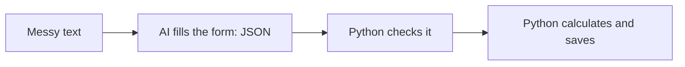

# Lesson 2.7: Structured Output

**Course:** Python for AI · **Module 2:** Core Python for Building LLM Apps · **Updated:** Oct 2026

> **By the end:** You can make the AI answer in clean JSON that your code can use, check that the data is real, and turn messy WhatsApp messages into orders, totals and a saved file. This is the skill behind most paid "AI data extraction" work.

---

## 1. Mental Model: Ask for a Form, Not an Essay

| Text answer | Structured answer (JSON) |
|---|---|
| "Sure! Ali wants 2 cupcakes delivered to Gulberg." | `{"customer": "Ali", "items": [{"name": "cupcake", "quantity": 2}], "address": "Gulberg"}` |
| Made for **humans** to read | Made for **code** to use |
| Different wording every time | Same shape every time |



**Golden rule:** the AI **reads and fills the form**. Python **checks, calculates and saves**. Never let the AI do the maths.

---

## 2. The Problem with Free Text

```python
answer = "Sure! Here is the data: {\"sentiment\": \"positive\"}"
data = json.loads(answer)   # JSONDecodeError: the extra words break it
```

Models love to add "Sure! Here is...". Your code needs **only** the JSON.

---

## 3. Level 1: `format="json"`

```python
import json

from langchain.chat_models import init_chat_model

# format="json": the reply must be valid JSON; temperature 0: same answer every time
json_llm = init_chat_model("llama3.2", model_provider="ollama", temperature=0, format="json")

review = "The chocolate cake was amazing but delivery was 1 hour late."

response = json_llm.invoke([
    {"role": "system", "content": 'Classify the review. Reply in JSON with keys "sentiment" (positive, negative or mixed) and "reason" (max 10 words).'},
    {"role": "user", "content": review},
])

data = json.loads(response.text)
print(data["sentiment"])   # mixed
print(data["reason"])
```

`format="json"` guarantees **valid JSON**, but not **which keys**. The model could still answer with `"mood"` instead of `"sentiment"`.

---

## 4. Level 2: A JSON Schema (the Exact Shape)

A **schema** is a dictionary that describes the exact form: which keys, which types, which are required.

```python
ORDER_SCHEMA = {
    "type": "object",
    "properties": {
        "customer": {"type": "string"},
        "items": {
            "type": "array",
            "items": {
                "type": "object",
                "properties": {
                    "name": {"type": "string"},
                    "quantity": {"type": "integer"},
                },
                "required": ["name", "quantity"],
            },
        },
        "address": {"type": "string"},
    },
    "required": ["customer", "items", "address"],
}
```

| Schema word | Meaning |
|---|---|
| `"type": "object"` | A dictionary |
| `"properties"` | The keys it can have, and the type of each |
| `"required"` | Keys that must always be there |
| `"type": "array"` + `"items"` | A list, and what each item looks like |
| `"string"` / `"integer"` / `"number"` / `"boolean"` | `str` / `int` / `float` / `bool` |

Pass it when you create the model: `init_chat_model(..., format=ORDER_SCHEMA)`. Now the model **must** return this exact shape.

---

## 5. Always Check the Data

Valid JSON can still be **wrong**. Pros check four things:

```python
# 1. Is it JSON at all?
try:
    order = json.loads(response.text)
except json.JSONDecodeError:
    order = {}

# 2. Are the keys there?
customer = order.get("customer", "")

for item in order.get("items", []):
    # 3. Is the type right? isinstance(value, type) gives True or False
    if not isinstance(item["quantity"], int):
        print("Quantity is not a whole number")

    # 4. Is it real? Check against data YOU trust
    if item["name"] not in PRICES:
        print(f"{item['name']} is not on our menu")
```

**Hallucination check:** if the AI says the customer is "Ahmed" but "ahmed" is nowhere in the original message, the AI **invented** it.

```python
if customer != "" and customer.lower() not in message.lower():
    print(f"Check by hand: '{customer}' is not in the message")
```

---

## 6. Mini Build: WhatsApp Order Extractor

```python
"""Lesson 2.7: Turn messy WhatsApp orders into checked JSON orders with totals."""

import json

from langchain.chat_models import init_chat_model

PRICES = {"chocolate cake": 1500, "cupcake": 250, "brownie": 300}

ORDER_SCHEMA = {
    "type": "object",
    "properties": {
        "customer": {"type": "string"},
        "items": {
            "type": "array",
            "items": {
                "type": "object",
                "properties": {"name": {"type": "string"}, "quantity": {"type": "integer"}},
                "required": ["name", "quantity"],
            },
        },
        "address": {"type": "string"},
    },
    "required": ["customer", "items", "address"],
}

# The exact shape we need, and temperature 0 so the same message gives the same result
extractor = init_chat_model("llama3.2", model_provider="ollama", temperature=0, format=ORDER_SCHEMA)

SYSTEM = (
    "Extract the bakery order from the WhatsApp message. "
    f"Item names must be one of: {', '.join(PRICES)}. "  # join glues the menu names into one string
    "If the customer name or address is not in the message, use an empty string. "
    "If it is not an order, return an empty items list. Never invent details."
)

messages_in = [
    "Salam! 2 cupcakes aur 1 chocolate cake chahiye. Ali, house 12 Gulberg",
    "3 brownies please, Sara, DHA phase 5",
    "hi do you deliver to Johar Town?",
]

saved = []

for message in messages_in:
    response = extractor.invoke([{"role": "system", "content": SYSTEM}, {"role": "user", "content": message}])

    try:
        order = json.loads(response.text)
    except json.JSONDecodeError:
        print(f"Could not read the AI reply for: {message}")
        continue

    print(f"\nMessage: {message}")
    items = order.get("items", [])
    if len(items) == 0:
        print("  Not an order: needs a human reply.")
        continue

    # Python does the maths with OUR prices, never the AI's
    total = 0
    problems = []
    for item in items:
        name = item["name"].lower()
        if name not in PRICES:
            problems.append(f"'{item['name']}' is not on the menu")
            continue
        line = PRICES[name] * item["quantity"]
        total += line
        print(f"  {item['quantity']} x {name} = {line} PKR")

    customer = order.get("customer", "")
    if customer != "" and customer.lower() not in message.lower():
        problems.append(f"customer '{customer}' is not in the message (invented?)")

    order["total"] = total
    order["problems"] = problems
    saved.append(order)
    print(f"  Customer: {customer or '(missing)'}, Address: {order.get('address') or '(missing)'}")
    print(f"  Total: {total} PKR")
    for p in problems:
        print(f"  CHECK: {p}")

with open("orders.json", "w", encoding="utf-8") as f:
    json.dump(saved, f, indent=2, ensure_ascii=False)
print(f"\nSaved {len(saved)} orders to orders.json")
```

---

## 7. Class Activity: Hallucination Hunt

Add these tricky messages to `messages_in`, run the extractor, and record what the AI got wrong.

| Message | Trap |
|---|---|
| `"do cupcakes bhej dein"` | "do" means 2 in Urdu. Did the AI get quantity 2? |
| `"1 pizza and 2 brownies"` | Pizza is not on the menu. Was it flagged? |
| `"same as last time please"` | No items at all. Did the AI invent an order? |
| `"Bilal: 2 cakes, Model Town"` | "cakes" could mean chocolate cake. Did it guess? |
| `"I want five brownies"` | Number in words. Is quantity 5? |

Score 1 point for every mistake your **checks** caught, and 1 point for every mistake that slipped through and needs a new check. Share the best new check with the class.

---

## 8. Common Errors and Traps

| Problem | Cause | Fix |
|---|---|---|
| `JSONDecodeError` | No `format=`, so the model added extra words | Create the model with `format="json"` or a schema |
| `KeyError: 'sentiment'` | `format="json"` alone does not fix the keys | Use a schema, or `.get()` with a default |
| `TypeError: unsupported operand type(s) for +=: 'int' and 'str'` | Quantity came back as text `"2"`, so `1500 * "2"` silently made a string of 1,500 twos | `"type": "integer"` in the schema, and `int()` to be safe |
| Items not on the menu | The model guessed | List the allowed names in the prompt **and** check against `PRICES` |
| Wrong total | Let the AI calculate | Calculate in Python with your own prices |
| Different results each run | High temperature | Create the extractor with `temperature=0` |

---

## 9. Job & Client Angle

- **Data extraction is a top beginner gig.** Invoices, CVs, receipts, WhatsApp orders and reviews into JSON, then into Excel or a database.
- **Checks are what clients pay for.** "Every order is checked against your menu and flagged if something looks invented" is a sentence that wins contracts.
- **Structured output powers agents.** In Lesson 2.8 the AI returns structured data to choose which Python tool to run.

---

## 10. Your Task (self-create)

Build an **Order Extractor** in `code/lesson_2_7_extractor.py` for your own business: messy customer messages in, checked JSON orders out, totals calculated in Python and saved to `orders.json`.

**Full requirements, expected output, stretch goal and marking:** [Task 2.7: Order Extractor](../assessments/module-2/checkpoint-2-code-tasks.md#task-27-order-extractor)

Run the hallucination hunt from Section 7, then push to GitHub.

---

## Key Takeaways

- Ask the AI for a **form (JSON)**, not an essay, when code will use the answer
- `format="json"` = valid JSON; `format=schema` = the **exact shape** (set in `init_chat_model`)
- Use `temperature=0` for extraction
- **Always check:** valid JSON, keys, types, and real values against data you trust
- The AI extracts; **Python calculates**

### Quick Check
1. What is the difference between `format="json"` and `format=ORDER_SCHEMA`?
2. Why do we calculate the total in Python instead of asking the AI?
3. How can you tell that a customer name might be invented?

---

## Must-Have Resources

- LangChain + Ollama (ChatOllama, `format`): https://docs.langchain.com/oss/python/integrations/chat/ollama
- Ollama structured outputs: https://ollama.com/blog/structured-outputs
- JSON Schema, step by step: https://json-schema.org/learn/getting-started-step-by-step
- Python `json` module: https://docs.python.org/3/library/json.html

**Next:** Lesson 2.8: Your First Agent
