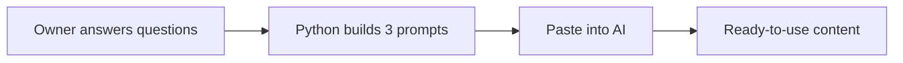

# Module 1, Checkpoint 1 Project: AI Prompt Kit for a Local Business

**Course:** Python for AI · **Module 1:** Python Basics for GenAI and Agentic AI · **Covers:** Lessons 1.1 to 1.4 · **Updated:** Wed 14 Oct 2026 - 3:58 PM

> **Your first client-style project.** You will build a small Python tool that turns a business's details into ready-to-use AI prompts, test them on a real AI model, and present it like a freelancer.

---

## 1. The Client Story

A local business owner (bakery, clinic, tuition centre, mobile shop, salon) says:

*"I keep hearing about AI, but I don't know what to type. Give me something that writes good AI prompts for my business."*

**Your job:** build a tool that asks a few questions and prints **3 professional prompts** they can paste into any AI (Ollama, Claude, ChatGPT).



---

## 2. What You Will Use (Lessons 1.1 to 1.4 only)

| Skill | From |
|---|---|
| Prompts, tokens, hallucination awareness | 1.1 |
| Ollama for testing | 1.2 |
| uv project, `uv run`, GitHub | 1.3 |
| `print()`, `input()`, f-strings, `int()`, comments | 1.4 |

No loops, if/else or functions needed. Keep it simple and clean.

---

## 3. Requirements

**File:** `code/project_m1_prompt_kit.py`

1. **Docstring** at the top: what the tool does and who it is for
2. **Ask 5 questions** with `input()`:
   - Business name
   - Business type (e.g. bakery)
   - City
   - Main customers (e.g. students, families)
   - Monthly budget in PKR (convert with `int()`)
3. **Print a header** with the business name
4. **Build and print 3 prompts** using f-strings:
   - **Prompt 1, Marketing:** a social media post idea
   - **Prompt 2, Customer Service:** a polite reply to an unhappy customer
   - **Prompt 3, Growth:** 3 low-cost AI ideas within the budget
5. At least **3 comments** explaining **why**
6. Clean, readable output with separators

**Expected output (example)**
```text
Business name: Sweet Crumbs
Business type: bakery
City: Lahore
Main customers: university students
Monthly budget (PKR): 15000

=========================================
   AI Prompt Kit for Sweet Crumbs
=========================================

[1] Marketing
Write a short Instagram post for Sweet Crumbs, a bakery in Lahore.
Target university students. Friendly tone, 1 call to action.

[2] Customer Service
You are the manager of Sweet Crumbs. Write a polite reply to a customer
whose order arrived late. Apologise and offer a small discount.

[3] Growth
Suggest 3 low-cost AI tools a bakery in Lahore can use
to attract university students with a budget of 15000 PKR per month.
```

**Tip:** a good prompt names a **role**, a **task**, the **audience** and a **tone or number**. Vague prompts get vague answers.

---

## 4. Test It Like a Pro

1. Run your tool for **one real business** (family shop, friend's business, or one near you)
2. Paste each prompt into **Ollama**
3. Save results in `docs/project-m1-results.md` using this template:

```markdown
# Module 1 Project: AI Test Results

**Business:** (name, type, city)
**Model:** (e.g. llama3.2)

## Prompt 1: Marketing
**Prompt:** ...
**AI answer:** ...
**Useful?** Yes / No, because ... (anything wrong or made up?)

## Prompt 2: Customer Service
...

## Prompt 3: Growth
...
```

Watch for **hallucinations**: tools, prices or facts the AI invented. Say so honestly.

---

## 5. Deliverables

| # | Deliverable | Where |
|---|---|---|
| 1 | Working script | `code/project_m1_prompt_kit.py` |
| 2 | AI test results | `docs/project-m1-results.md` |
| 3 | Screenshot of the tool running | `docs/project-m1-run.png` |
| 4 | Updated README (project section + run command) | `README.md` |
| 5 | 3-minute live demo | In class |

**README project section template:**

```markdown
## Module 1 Project: AI Prompt Kit

A Python tool that turns a local business's details into 3 ready-to-use AI prompts.

**Run:** `uv run code/project_m1_prompt_kit.py`


**Who would pay for this:** (one line, e.g. small shop owners who want AI help but don't know what to type)
```

---

## 6. The 3-Minute Demo (pitch it like a freelancer)

| Time | Say |
|---|---|
| 0:00 to 0:30 | The problem: which business, what they struggle with |
| 0:30 to 1:30 | Live run: answer the questions, show the 3 prompts |
| 1:30 to 2:30 | One AI result: what worked, what was wrong |
| 2:30 to 3:00 | How you would sell or improve it |

**Be ready:** after your demo you will be asked to explain one line of your code in your own words.

---

## 7. How You Will Be Marked (100 marks)

| Criteria | Marks | Full marks when |
|---|---|---|
| **Works** | 25 | Runs with `uv run`, no errors, budget converted with `int()` |
| **Requirements** | 20 | 5 inputs, header, 3 prompts, docstring, 3 "why" comments |
| **Prompt quality** | 15 | Prompts are specific: role, task, audience, tone or number |
| **AI testing** | 15 | All 3 prompts tested, honest judgement on each answer |
| **Repo & README** | 10 | Clean structure, screenshot, run command, client value line |
| **Demo & explanation** | 15 | Clear pitch, explains any line asked |

| Score | Level |
|---|---|
| 85 to 100 | Client-ready |
| 70 to 84 | Strong, minor fixes |
| 50 to 69 | Working, needs polish |
| Below 50 | Redo and resubmit |

**Important:** if you cannot explain your own code in the demo, your project is capped at 50 marks. AI tools are allowed, but understand every line you submit.

---

## 8. Bonus (+10, max 100)

- Add a **4th prompt** of your own idea (e.g. WhatsApp auto-reply, Google review response) (+5)
- Test the same prompt on **two different Ollama models** and compare (+5)

---

## 9. Before You Submit

- [ ] `uv run code/project_m1_prompt_kit.py` runs with no errors
- [ ] All 5 questions asked, budget converted with `int()`
- [ ] Header + 3 prompts printed with f-strings
- [ ] Docstring + at least 3 "why" comments
- [ ] `docs/project-m1-results.md` has all 3 prompts, answers and your judgement
- [ ] `docs/project-m1-run.png` screenshot added
- [ ] README project section added
- [ ] Demo practised once, under 3 minutes

---

## 10. Submission

- **Deadline:** before the Module 1 demo class
- **Commit message:** `Module 1 Checkpoint 1 Project: AI Prompt Kit`
- Push to your public `python-ai` repo and share the link

**Why this project matters:** "I build AI prompt tools for small businesses" is a real service you can offer on Fiverr, Upwork or to local shops. In Module 2, this tool will **send the prompts to AI automatically** instead of you copy-pasting.
