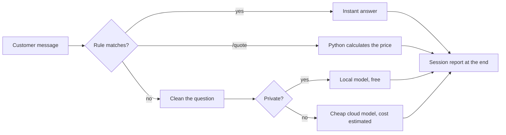

# Module 1, Checkpoint 2 Project: AI Front Desk for a Local Business

**Course:** Python for AI · **Module 1:** Python Basics for GenAI and Agentic AI · **Covers:** Lessons 1.1 to 1.8 · **Updated:** Oct 2026

> **Your Module 1 final project.** You will build a front desk assistant that answers common questions with rules, gives exact price quotes, and turns every question it cannot answer into a clean, cost-checked AI prompt. Then you will test it and present it like a freelancer.

---

## 1. The Client Story

The owner of a local business (bakery, clinic, tuition centre, salon, mobile shop) says:

*"My staff answer the same questions all day, make mistakes on price quotes, and I have no idea what customers really ask. Can AI help, without a big bill?"*

**Your job:** build a front desk that:
1. Answers the common questions **instantly and for free** (rules)
2. Gives **exact price quotes** with discounts and delivery fees (Python maths)
3. Prepares an **AI-ready prompt** for anything else, sends private questions to a local model, and estimates the cost
4. Ends with a **session report** the owner can act on



---

## 2. What You Will Use (Lessons 1.1 to 1.8 only)

| Skill | From |
|---|---|
| Prompts, tokens, local vs cloud models | 1.1, 1.2 |
| `uv run`, GitHub, README | 1.3 |
| `print()`, `input()`, f-strings, comments | 1.4 |
| Variables, `int`, `float`, `bool`, constants in `UPPER_CASE` | 1.5 |
| `.strip()`, `.lower()`, `.capitalize()`, `in`, slicing, `:,` and `:.2f` | 1.6 |
| Maths operators, `if / elif / else`, `and` / `or` | 1.7 |
| `while True`, `break`, counters, rule order | 1.8 |

**No lists, dictionaries, `for` loops or functions.** Those come in Module 2. Solving it with Module 1 tools only proves you understand the basics.

---

## 3. Requirements

**File:** `code/project_m1_front_desk.py`

**A. Start and memory**
1. Docstring at the top: what the tool does and for which business
2. Constants at the top in `UPPER_CASE`: bot name, delivery fee, free-delivery limit, example cloud price per 1K tokens
3. A header with separators, then ask the customer's name **once, before the loop**, cleaned with `.strip().title()`

**B. FAQ rules** (inside `while True`)
4. At least **5 intents** for your business (hours, location, delivery, fees, greeting...)
5. Every message cleaned with `.strip().lower()`
6. **Complaint rule first** (refund, complaint, late), so unhappy customers always reach a human
7. Greetings checked with `==` or `.startswith()`, not `in`
8. `bye` ends the chat with `break`; empty input asks again

**C. `/quote` price calculator**
9. Ask for the item and the quantity (`int(input())`)
10. At least **3 items** priced with `if / elif / else`; an unknown item gets a polite "not on our menu"
11. A **bulk discount rule** (for example 10% off for 10 or more) and a **delivery rule** (a fee, free above a limit)
12. Print the subtotal, discount, delivery and total with thousand separators (`:,`)

**D. Smart fallback** (anything the rules cannot answer)
13. Clean the question with `.capitalize()` and cut it to **150 characters** with slicing
14. Estimate tokens (characters / 4, rounded)
15. **Route it:** private details (phone, CNIC, address) go to a local model at 0 cost; everything else goes to a cheap cloud model with an estimated cost
16. Print the chosen model and a **multi-line f-string prompt** that includes the customer's name

**E. Session report** (after the loop)
17. Messages, answered by rules, unanswered, number of quotes, total quoted value, and total estimated AI cost

**F. Code quality**
18. `snake_case` names, no reused built-in names, and at least **4 comments** explaining **why**

**Expected output (example business: Sweet Crumbs bakery; yours will differ)**
```text
==================================================
   Sweet Crumbs Desk: rules, quotes and AI-ready prompts
==================================================
Ask anything, type /quote for a price, or bye to exit.
Sweet Crumbs Desk: What is your name?   ali raza
Ali Raza: What are your HOURS?
Sweet Crumbs Desk: We are open 9 am to 10 pm, every day.
Ali Raza: /quote
Sweet Crumbs Desk: Which item? cupcake
Sweet Crumbs Desk: How many? 12
Sweet Crumbs Desk: 12 x cupcake = 3,000 PKR
     Discount: -300 PKR | Delivery: 200 PKR
     Total: 2,900 PKR
Ali Raza: /quote
Sweet Crumbs Desk: Which item? pizza
Sweet Crumbs Desk: How many? 2
Sweet Crumbs Desk: Sorry, pizza is not on our menu.
Ali Raza: Do you make sugar-free cakes?
Sweet Crumbs Desk: Good question! Routed to: small cloud model (cheap) (~7 tokens)
     Prompt: You are the assistant of Sweet Crumbs bakery.
     Answer Ali Raza in 2 short lines. Question: Do you make sugar-free cakes?
Ali Raza: can I change my phone number on the order?
Sweet Crumbs Desk: Good question! Routed to: llama3.2 (local, private) (~10 tokens)
     Prompt: You are the assistant of Sweet Crumbs bakery.
     Answer Ali Raza in 2 short lines. Question: Can i change my phone number on the order?
Ali Raza: my order is late
Sweet Crumbs Desk: Sorry about that. A manager will call you within 1 hour.
Ali Raza: bye
Sweet Crumbs Desk: Goodbye, Ali Raza!
==================================================
Session report
Messages: 7 | Answered by rules: 3 | Unanswered: 2
Quotes: 1 | Quoted value: 2,900 PKR
Estimated AI cost for unanswered questions: 0.0007 PKR
==================================================
```

**Look closely at the quote:** 12 cupcakes cost 3,000 PKR, but after the 10% discount the order is 2,700 PKR, which is **below** the free-delivery limit, so delivery is still charged. Decide the order of your rules on purpose, and explain it in your demo.

---

## 4. Design First

Before coding, create `docs/project-m1-part2-design.md` with two tables.

**Intents** (at least 5)

| Intent | Keywords | Reply |
|---|---|---|
| Complaint | refund, complaint, late | A manager will call you |
| ... | ... | ... |

**Business rules**

| Rule | Value |
|---|---|
| Item prices | e.g. cupcake 250 PKR, brownie 300 PKR, chocolate cake 1,500 PKR |
| Bulk discount | e.g. 10% off for 10 or more |
| Delivery | e.g. 200 PKR, free from 3,000 PKR |
| Private words | e.g. phone, cnic, my address |

---

## 5. Test Like a Pro

**Rule tests.** Add this table to your design file with a "Pass?" column, and run every row:

| You type | Expected |
|---|---|
| `  WHAT are your hours  ` | Hours (capitals and spaces handled) |
| `which cake is best?` | Fallback, **not** a greeting ("hi" hides in "which") |
| `my order is late` | Manager reply (complaint rule first) |
| `/quote`, 1 of your most expensive item | Delivery fee charged |
| `/quote`, a big order above the free-delivery limit | Delivery free |
| `/quote`, 10 or more items | Discount applied |
| `/quote`, an item not on your menu | "Not on our menu", no crash |
| A question with "phone" or "cnic" | Routed to the local model, cost 0 |
| Press Enter with no text | Asks again |
| `BYE` | Goodbye + session report |

**AI test.** Paste **two** prompts your bot printed into **Ollama**. Save in `docs/project-m1-part2-results.md`:
- The prompt and the AI's answer
- One line per answer: **useful or not, and why?** (watch for hallucinations: invented prices, timings or promises)

---

## 6. Deliverables

| # | Deliverable | Where |
|---|---|---|
| 1 | Working script | `code/project_m1_front_desk.py` |
| 2 | Design tables + rule test results | `docs/project-m1-part2-design.md` |
| 3 | AI test results | `docs/project-m1-part2-results.md` |
| 4 | Screenshot of a full session with the report | `docs/project-m1-part2-run.png` |
| 5 | README project section | `README.md` |
| 6 | 3-minute live demo | In class |

**README project section must include:**
- Project name and one-line description
- Run command: `uv run code/project_m1_front_desk.py`
- Screenshot
- One line: how much staff time or money this saves the owner, and why they would pay for it

---

## 7. The 3-Minute Demo (pitch it like a freelancer)

| Time | Show |
|---|---|
| 0:00 to 0:30 | The business and its problem |
| 0:30 to 1:30 | Live run: one FAQ, one quote with a discount, one question routed to AI |
| 1:30 to 2:15 | The session report: what it tells the owner |
| 2:15 to 3:00 | One AI test result (what worked, what was wrong) and your next improvement |

**Be ready:** after your demo you will be asked to explain one line of your code in your own words.

---

## 8. How You Will Be Marked (100 marks)

| Criteria | Marks | Full marks when |
|---|---|---|
| **Works** | 25 | Runs with `uv run`, no errors in the normal tests, report always prints |
| **Requirements** | 20 | Sections A to F all done |
| **Logic and rule order** | 15 | Complaint first, greeting trap avoided, discount and delivery rules correct |
| **Testing** | 15 | Rule test table completed honestly, 2 AI tests with a judgement |
| **Repo and README** | 10 | Clean structure, design file, screenshot, run command, value line |
| **Demo and explanation** | 15 | Clear pitch, explains any line asked |

| Score | Level |
|---|---|
| 85 to 100 | Client-ready |
| 70 to 84 | Strong, minor fixes |
| 50 to 69 | Working, needs polish |
| Below 50 | Redo and resubmit |

**Important:** if you cannot explain your own code in the demo, your project is capped at 50 marks. AI tools are allowed, but understand every line you submit.

---

## 9. Bonus (+10, max 100)

- **Safe quantity (+5):** typing letters for the quantity crashes with `ValueError`. Check with `.isdigit()` before `int()` and reply politely instead. (In Module 2 you will learn `try / except` for this.)
- **Human handover (+5):** an `agent` or `human` keyword ends the chat with `Connecting you to a human...`, and the report shows how many complaints came in.

---

## 10. Before You Submit

- [ ] `uv run code/project_m1_front_desk.py` runs with no errors
- [ ] Constants in `UPPER_CASE`, name asked once before the loop
- [ ] At least 5 intents, complaint rule first, greeting trap avoided
- [ ] `/quote` with 3+ items, discount rule, delivery rule, `:,` formatting
- [ ] Fallback cleans, slices to 150, estimates tokens, routes private questions locally
- [ ] Session report with all 6 numbers
- [ ] Only Module 1 tools: no lists, dictionaries, `for` loops or functions
- [ ] Docstring + at least 4 "why" comments
- [ ] Design file with intents, business rules and the completed test table
- [ ] 2 AI tests saved with your judgement
- [ ] Screenshot and README section added
- [ ] Demo practised once, under 3 minutes

---

## 11. Submission

- **Deadline:** before the Module 1 final demo class
- **Commit message:** `Module 1 Checkpoint 2 Project: AI Front Desk`
- Push to your public `python-ai` repo and share the link

**Why this project matters:** a front desk that answers the easy questions for free, quotes prices exactly, and only spends AI money where it adds value is what small businesses actually need. In Module 2, your printed prompts are **sent to a real AI automatically** (Lesson 2.1), and your price list moves into a dictionary (Lesson 2.3).
