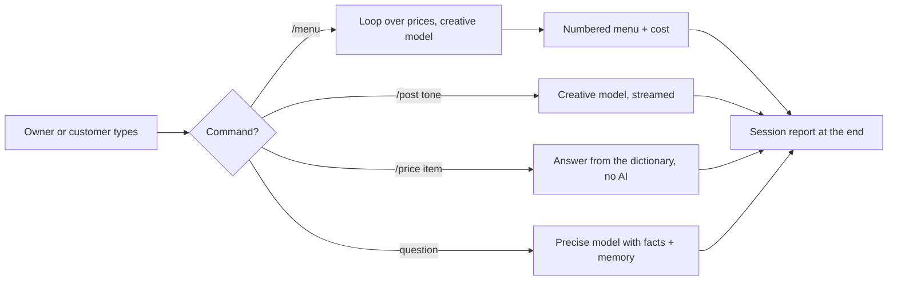

# Module 2, Checkpoint 1 Project: AI Content Studio for a Local Business

**Course:** Python for AI · **Module 2:** Core Python for Building LLM Apps · **Covers:** Lessons 2.1 to 2.4 · **Updated:** Oct 2026

> **Your first real AI product.** You will build a content studio that writes a whole menu in one run, streams social media posts in different tones, answers prices from real data, and chats with customers using memory. Then you will test it and present it like a freelancer.

---

## 1. The Client Story

The owner of a local business (bakery, clinic, tuition centre, salon, mobile shop) says:

*"I have no time for marketing. My menu has no descriptions, I post on Instagram once a month, and customers keep asking the same questions. I tried ChatGPT, but it made up a price. Can you build me something that uses my real information?"*

**Your job:** build a studio that:
1. Writes a **description for every product** in one batch, and reports the cost
2. Writes **social media posts** in the tone the owner chooses, streamed word by word
3. Answers **prices instantly** from your data, without the AI
4. **Chats** with customers, remembers the conversation, and only uses real facts
5. Ends with a **session report** of everything the AI did and what it cost



---

## 2. What You Will Use (Lessons 2.1 to 2.4 only)

| Skill | From |
|---|---|
| `init_chat_model`, `.invoke()`, `response.text`, system messages, temperature | 2.1 |
| `usage_metadata` and `response_metadata` (tokens and time), `llm.stream()` | 2.1 |
| Lists, `.append()`, the messages list, trimming with slices | 2.2 |
| Dictionaries, nested data, `.get()` with a default, grounding with facts | 2.3 |
| `for` loops, `.items()`, `continue`, accumulators, `enumerate` | 2.4 |
| Everything from Module 1: `while True`, `if / elif / else`, f-strings, string methods | 1.4 to 1.8 |

**No functions, files or `try / except`.** Those come in Lessons 2.5 and 2.6. You will upgrade this project then.

---

## 3. Requirements

**File:** `code/project_m2_content_studio.py`

**A. Setup and data**
1. Docstring at the top: what the studio does and for which business
2. A `config` dictionary with at least the model name and the memory size
3. A `facts` dictionary with at least **5 keys** (name, city, hours, delivery...), including a nested `prices` dictionary with at least **4 items**, one of them with price `0` ("coming soon")
4. A `tones` dictionary with at least **3 tones** for posts
5. **Two models, created once at the top:** `precise` (temperature 0.2 or lower) and `creative` (temperature 0.7 or higher)
6. A system message built from `facts` with an f-string, that tells the AI to **only use these facts** and to say so when it does not know

**B. The command loop** (`while True`)
7. A header with separators and a line listing all commands
8. Commands: `/menu`, `/post <tone>`, `/price <item>`, `/reset`, `bye`; anything else is a chat question
9. Empty input asks again; `bye` ends the loop with `break`; commands work with any capitals

**C. `/menu`: batch descriptions**
10. Loop over `facts["prices"]` with `.items()`; skip price-0 items with `continue` and print that they were skipped
11. Use the **creative** model for a one-sentence description of each item
12. Collect the results in a **list of dictionaries**, then print a numbered menu with `enumerate` and prices with `:,`
13. Add every call's tokens and seconds to accumulators

**D. `/post <tone>`: streamed social media post**
14. Read the tone name after `/post`, and look it up with `.get()` and a default, so a wrong tone still works
15. Use the **creative** model with `.stream()`, printing each chunk as it arrives

**E. `/price <item>` and chat with memory**
16. `/price` answers from the dictionary **without calling the AI**: a real price, "coming soon" for price `0`, or "not on our menu"
17. Chat questions use the **precise** model with the messages list: append the user message, trim to the system message plus the last `config["max_messages"]`, call the AI, append the reply
18. After each chat answer, print the memory size and the tokens sent
19. `/reset` clears the chat but keeps the system message

**F. Session report and code quality**
20. After the loop, print: chat answers, menu descriptions, posts, price answers, total tokens (with `:,`) and total AI seconds (1 decimal)
21. `snake_case` names, no reused built-in names, and at least **4 comments** explaining **why**

**Expected output (example business: Sweet Crumbs bakery; AI answers, tokens and times will differ)**
```text
==================================================
   Sweet Crumbs AI Content Studio
==================================================
Commands: /menu, /post fun|premium|urgent, /price <item>, /reset, bye
You: /menu
Studio: Skipping mango tart (coming soon)
--------------------------------------------------
1. Chocolate Cake (1,500 PKR)
   Rich, moist layers of pure chocolate, baked fresh in Lahore every morning.
2. Cupcake (250 PKR)
   A soft, swirled little treat that makes any tea time sweeter.
3. Brownie (300 PKR)
   Fudgy, gooey and packed with chocolate in every single bite.
--------------------------------------------------
You: /post premium
Studio (elegant and calm, focused on quality):
Some moments deserve more than ordinary.
Our chocolate cake, baked by hand every morning, 1,500 PKR.
Sweet Crumbs, Lahore. Open 9 am to 10 pm.
You: /price CUPCAKE
Studio: Cupcake costs 250 PKR.
You: /price mango tart
Studio: Mango Tart is coming soon.
You: Do you deliver to DHA?
Studio: Yes! Delivery is 200 PKR, and free for orders from 3,000 PKR.
        (memory: 3 messages, 112 tokens sent)
You: Do you sell pizza?
Studio: Sorry, I only know about our bakery items, and pizza is not one of them.
        (memory: 5 messages, 141 tokens sent)
You: bye
Studio: Goodbye!
==================================================
Session report
Chat answers: 2 | Menu descriptions: 3 | Posts: 1 | Price answers: 2
AI usage: 612 tokens in 9.4 seconds
==================================================
```

**Look closely:** the menu skips the price-0 item **before** calling the AI, so it costs nothing. `/price` never spends a token. Decide on purpose which jobs need the AI and which do not, and explain it in your demo.

---

## 4. Design First

Before coding, create `docs/project-m2-cp1-design.md` with three tables.

**Facts** (at least 5 keys and 4 prices)

| Key | Value |
|---|---|
| name | Sweet Crumbs |
| prices | chocolate cake 1,500 PKR, cupcake 250 PKR, brownie 300 PKR, mango tart 0 (coming soon) |
| ... | ... |

**Tones** (at least 3)

| Tone | Description sent to the AI |
|---|---|
| fun | playful and full of energy, short sentences |
| ... | ... |

**Which model for which job**

| Job | Model and temperature | Why |
|---|---|---|
| Menu descriptions | creative, 0.8 | Marketing text should be varied |
| ... | ... | ... |

---

## 5. Test Like a Pro

**Feature tests.** Add this table to your design file with a "Pass?" column, and run every row:

| You type | Expected |
|---|---|
| `/menu` | Price-0 item skipped, numbered menu, prices with commas |
| `/post` with each of your tones | Post streams word by word, in a different style each time |
| `/post pirate` (a tone that does not exist) | Default tone used, no `KeyError` |
| `/price` with a real item in CAPITALS | Correct price |
| `/price` with your price-0 item | "Coming soon" |
| `/price` with an item not on your menu | "Not on our menu", no crash |
| `My name is Ali`, then `What is my name?` | Remembers the name |
| `/reset`, then `What is my name?` | Does not know |
| Press Enter with no text | Asks again |
| `BYE` | Goodbye + session report with all numbers |

**AI quality test.** Ask the chat **three** questions and save them in `docs/project-m2-cp1-results.md`:
1. A question your facts answer (for example the hours)
2. A question about a price
3. A question your facts **cannot** answer (for example a product you do not sell)

For each one save the question, the AI's answer, and one line: **correct, or did it hallucinate?** Also save your best `/post` output and say which tone worked best for your business, and why.

---

## 6. Deliverables

| # | Deliverable | Where |
|---|---|---|
| 1 | Working script | `code/project_m2_content_studio.py` |
| 2 | Design tables + feature test results | `docs/project-m2-cp1-design.md` |
| 3 | AI quality test results | `docs/project-m2-cp1-results.md` |
| 4 | Screenshot of a full session with the report | `docs/project-m2-cp1-run.png` |
| 5 | README project section | `README.md` |
| 6 | 3-minute live demo | In class |

**README project section must include:**
- Project name and one-line description
- Run command: `uv run code/project_m2_content_studio.py`
- Screenshot
- One line: how much time or money this saves the owner, and why they would pay for it

---

## 7. The 3-Minute Demo (pitch it like a freelancer)

| Time | Show |
|---|---|
| 0:00 to 0:30 | The business and its problem |
| 0:30 to 1:30 | Live run: `/menu`, one `/post` streamed, one `/price` |
| 1:30 to 2:15 | A chat question the facts answer, and one they do not: does the bot invent anything? |
| 2:15 to 3:00 | The session report, and your next improvement |

**Be ready:** after your demo you will be asked to explain one line of your code in your own words.

---

## 8. How You Will Be Marked (100 marks)

| Criteria | Marks | Full marks when |
|---|---|---|
| **Works** | 25 | Runs with `uv run`, no errors in the feature tests, report always prints |
| **Requirements** | 20 | Sections A to F all done |
| **AI design** | 15 | Two models used for the right jobs, facts in the system message, memory trimmed but rules kept, no AI call where the dictionary can answer |
| **Testing** | 15 | Feature test table completed honestly, 3 AI quality tests with a judgement |
| **Repo and README** | 10 | Clean structure, `pyproject.toml` and `uv.lock` committed, design file, screenshot, value line |
| **Demo and explanation** | 15 | Clear pitch, explains any line asked |

| Score | Level |
|---|---|
| 85 to 100 | Client-ready |
| 70 to 84 | Strong, minor fixes |
| 50 to 69 | Working, needs polish |
| Below 50 | Redo and resubmit |

**Important:** if you cannot explain your own code in the demo, your project is capped at 50 marks. AI tools are allowed, but understand every line you submit.

---

## 9. Bonus (+10, max 100)

- **Post in two languages (+5):** `/post <tone>` also prints a Roman Urdu version of the same post, using the **precise** model and the English post as input.
- **Menu cost estimate (+5):** after `/menu`, print what the same tokens would cost on a cloud model, using an example price per 1K tokens in `config` (Lesson 1.7 maths, `:.2f`).

---

## 10. Before You Submit

- [ ] `uv run code/project_m2_content_studio.py` runs with no errors
- [ ] `config`, `facts` (5+ keys, 4+ prices, one at 0) and `tones` (3+) dictionaries
- [ ] Two models, created once at the top, used for the right jobs
- [ ] System message built from `facts`, says "only use these facts"
- [ ] `/menu`: `.items()`, `continue`, list of dictionaries, `enumerate`, accumulators
- [ ] `/post`: `.get()` with a default, streamed with `.stream()`
- [ ] `/price` answered from the dictionary for all three cases
- [ ] Chat with memory: trimmed, system message kept, `/reset` works
- [ ] Session report with all 6 numbers
- [ ] Only Lessons 2.1 to 2.4 tools: no functions, files or `try / except`
- [ ] Docstring + at least 4 "why" comments
- [ ] Design file with the three tables and the completed test table
- [ ] 3 AI quality tests saved with your judgement
- [ ] Screenshot and README section added
- [ ] Demo practised once, under 3 minutes

---

## 11. Submission

- **Deadline:** before Lesson 2.5
- **Commit message:** `Module 2 Checkpoint 1 Project: AI Content Studio`
- Push to your public `python-ai` repo and share the link

**Why this project matters:** "I build AI content tools that use your real business data" is a service small businesses pay for every month. In Lesson 2.5 you will turn each command into a reusable **function**, and in Lesson 2.6 the studio will **save** its menu and chat to files.
